# RFID Lab · 协议自优化平台操作指南

RFID Lab 用于管理 RFID 场景和协议，通过大模型生成候选协议，再完成验证、迭代和实验分析。应用源代码位于 [`code_add/`](code_add/)，本文件是仓库首页的图文操作指南。

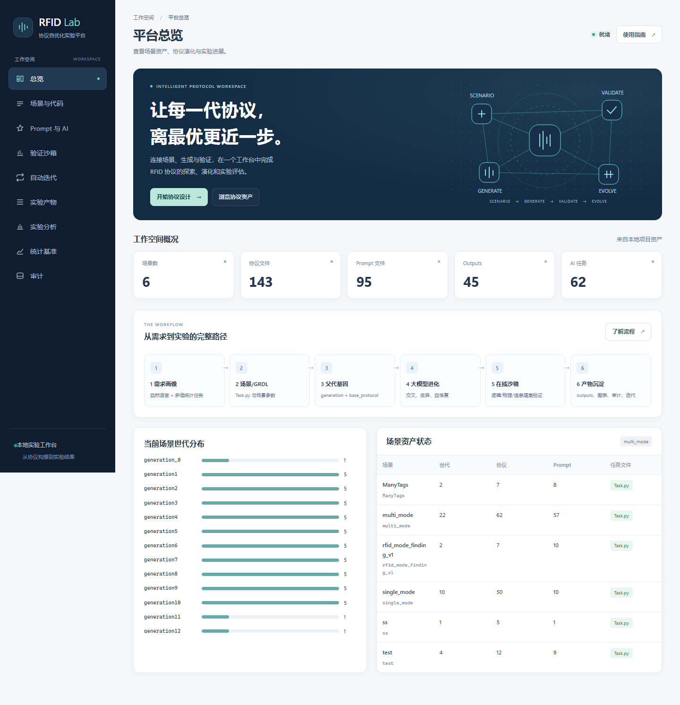

## 1. 下载与启动

本次验证环境为 Windows、Python 3.13.5 和 Microsoft Edge。Web 服务、文件预览和模型 HTTP 客户端使用 Python 标准库；实验分析使用 NumPy、pandas 和 Matplotlib。前端无需 npm 构建。

首次下载，在 PowerShell 中执行：

```powershell
git clone https://github.com/aozakiko/rfid.git
Set-Location .\rfid

# 在仓库根目录创建虚拟环境，不需要修改 PowerShell 的脚本执行策略。
python -m venv .venv
.\.venv\Scripts\python.exe -m pip install numpy pandas matplotlib

# 启动命令需要在 code_add 目录运行。
Set-Location .\code_add
..\.venv\Scripts\python.exe -m course_project.web_app --host 127.0.0.1 --port 8765
```

浏览器打开 **<http://127.0.0.1:8765>**。停止服务时，在运行服务的终端按 `Ctrl+C`。

如果当前 Python 环境已安装实验依赖，也可以直接执行：

```powershell
Set-Location "D:\HuaweiMoveData\Users\destiny\Desktop\大创\rfid\code_add"
python -m course_project.web_app --host 127.0.0.1 --port 8765
```

截图取自实际页面。基础工作区截图使用独立的临时审计数据库；统计基准截图使用当前已生成的20-seed实验结果和真实候选记录。截图中的本机绝对路径统一简写为 `code_add`，不会包含 API Key。运行时的数量、日期和结果随本地资产变化。

## 1.1 通用版本一键验证

本轮新增通用任务画像、协议适配、配置化 benchmark 和安全子进程执行。执行完整验证：

```powershell
Set-Location .\code_add
python -m tools.verify
```

该命令会执行语法检查、全量单元测试和临时 smoke benchmark。配置化实验入口见 [`docs/通用接口与运行基线v1.md`](docs/通用接口与运行基线v1.md)，本轮结果见 [`docs/通用版本本轮完成报告.md`](docs/通用版本本轮完成报告.md)。

## 2. 建议先走通的流程

1. 打开“场景与代码”，选择 `test` 场景，阅读 `ModeQuerySEM`、`ModeQueryTKQ` 等父代协议。
2. 在“Prompt 与 AI”选择上述两个父代，点击“预览生成任务”，检查生成的 Prompt。
3. 在“验证沙箱”选择 `ModeQuerySEM`，设置 60 个标签、2 次验证，查看检查结果。
4. 在“自动迭代”填入 `ModeQuerySEM, ModeQueryTKQ, g2_2`，勾选“只预览迭代任务，不调用模型”，先体验两轮迭代。
5. 在“实验产物”查看现有 CSV/JSON，在“实验分析”查看现有性能图。
6. 需要真实生成时，在“Prompt 与 AI”配置模型地址、模型名和 API Key，检查模型连接后再生成协议。

`test` 是场景目录名称；“任务画像”是统计目标。同一场景可以选择众数、均值、方差、分位数、基数或缺失盘点等任务画像。

## 3. 各页面操作

### 3.1 总览

查看场景数、协议数量、Prompt 数量、产物和任务统计；下方展示世代分布与场景资产。点击左侧导航进入各工作区，点击“使用指南”查看当前页面说明。

总览截图见本文件开头。

### 3.2 场景与代码

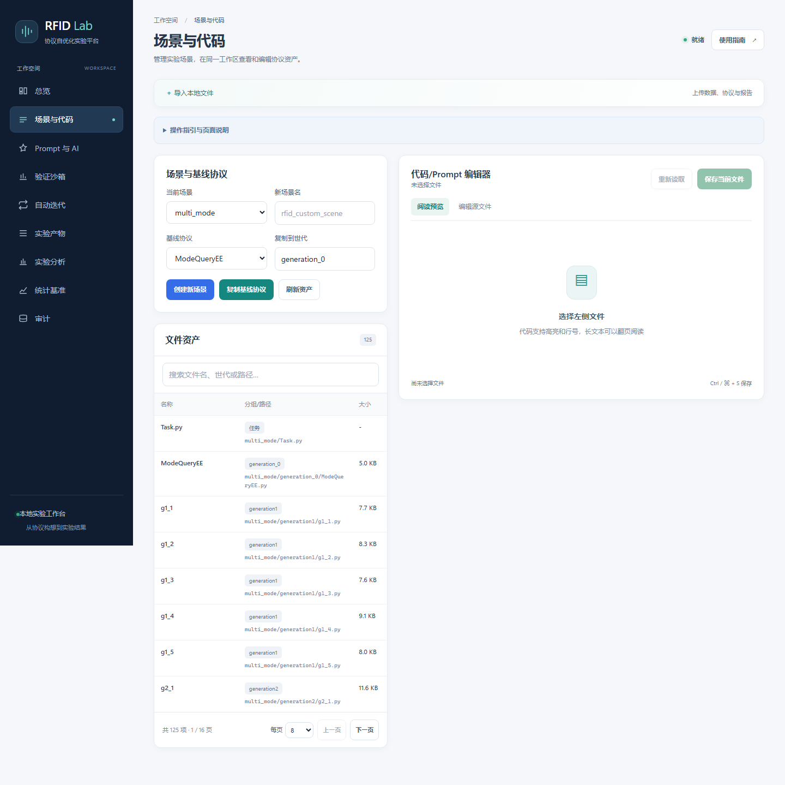

1. 选择已有场景；需要新场景时，填写合法名称并点击“创建新场景”。
2. 可以选择基线协议并复制到指定世代，例如 `generation_0`。
3. 用关键词搜索文件；列表支持每页 8、16、32 项和上一页/下一页。
4. 点击文件，右侧默认显示阅读预览。协议代码有行号和关键字高亮，长文件按页显示。
5. 点击“编辑源文件”修改内容，再点击“保存当前文件”或按 `Ctrl+S`。有未保存内容时，切换文件会提示确认。
6. 若保存提示文件已被其他操作修改，先重新读取并核对内容，再保存。

### 3.3 Prompt 与 AI

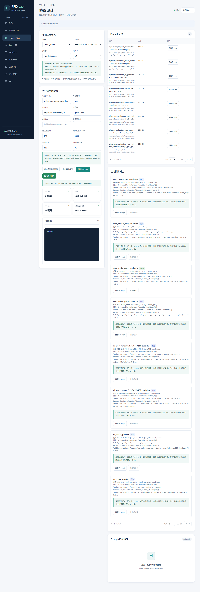

1. 选择场景、任务画像和父代 A/B，必要时补充业务需求。
2. 设置输出协议名、目标世代、修复轮数和验证标签数。
3. **预览生成任务**：生成 Prompt 和目标路径，不调用模型，不创建子代 `.py` 文件。
4. **生成协议代码**：实际调用配置的模型，生成代码并执行验证/自修复流程。
5. 下方查看后台任务进度、日志和历史记录；任务结束后会展示本次生成的 Prompt 或协议。

模型配置直接在页面填写 **API URL、API Key 和模型名**。例如使用 Pixel 时，URL 为 `https://ai-pixel.online/v1`，模型名填写该中转站支持的模型（当前示例为 `gpt-6.1-sol`），API Key 填写对应密钥。

点击“检查模型是否可用”验证连接，或点击“列出可用模型”查看支持的模型名称。系统自动识别 Responses / Chat Completions 接口，无需填写 Endpoint Path 或设置环境变量。修改 URL、Key 或模型名后，下一次模型检查、生成或自动迭代立即使用新配置，无需重启服务；已提交的任务继续使用提交时的配置。

API Key 仅在当前页面使用，不写入浏览器本地存储、配置文件或任务历史，刷新页面后需重新填写。自动迭代共用“Prompt 与 AI”页中的模型配置；预览生成和预览迭代不需要密钥，也不会调用模型。

### 3.4 验证沙箱

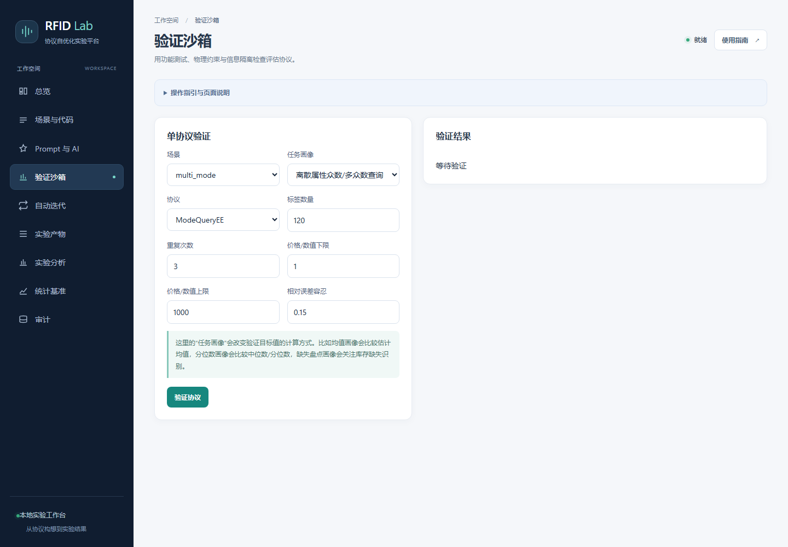

选择场景、协议、任务画像，设置标签数量、重复次数、数值范围和误差容忍度后，点击“验证协议”。

结果包括硬约束检查、功能命中率、信息隔离检查和平均耗时；环图展示命中比例，样本卡片展示单次结果。展开“检查报告与原始结果”可进一步查看报告、样本和嵌套数据。

### 3.5 自动迭代

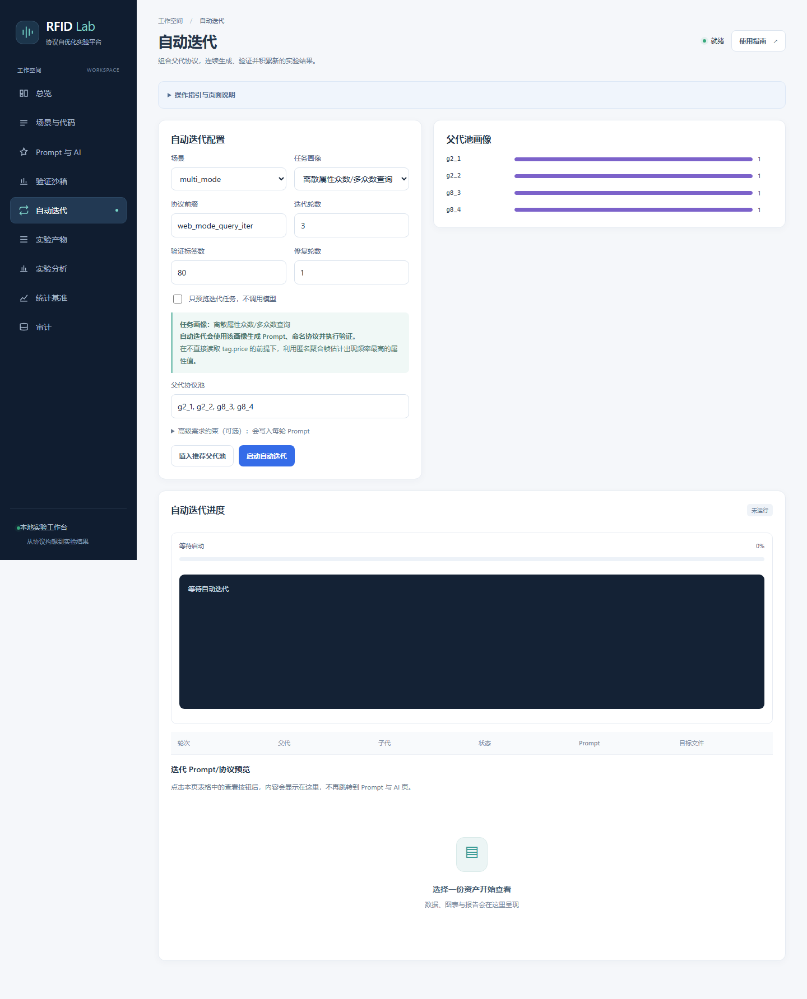

1. 选择场景、任务画像、协议前缀、迭代轮数、验证标签数和修复轮数。
2. 填入逗号分隔的父代协议池，或使用“填入推荐父代池”。父代必须存在于当前可用资产中。
3. 初次使用先勾选“只预览迭代任务，不调用模型”，再点击“启动自动迭代”。
4. 查看阶段进度、运行日志和轮次表；通过“查看 Prompt / 查看协议”阅读对应资产。
5. 需要真实生成时，先完成模型配置，再取消预览勾选并启动任务。

预览模式下显示“未生成协议”是预期行为；此时可以查看 Prompt，但没有新的协议源文件。

### 3.6 实验产物

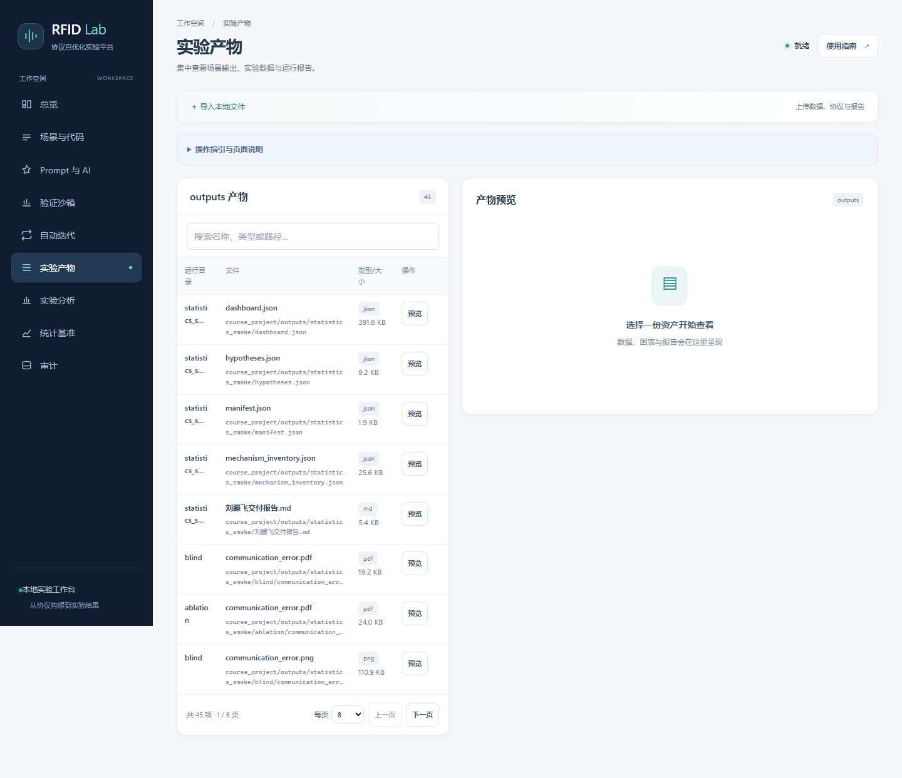

左侧集中展示平台和各场景 `outputs/` 中的产物。搜索文件名、路径或类型，点击“预览”后在右侧查看：

| 类型 | 展示方式 |
| --- | --- |
| CSV | 每页 20 条记录、字段选择、当前页趋势图、可横向滚动的宽表 |
| JSON | 按需展开对象和数组，也可以切换为 JSON 源文 |
| Markdown / Prompt | 阅读排版和带行号文本，长文件支持翻页 |
| Python / 日志 / 文本 | 行号与分页，Python 提供关键字高亮 |
| PNG / JPG / WebP / SVG | 适应容器或查看原始尺寸 |
| HTML / PDF | 内嵌报告或文档预览 |
| 其他产物 | 提供原始文件下载 |

点击“下载文件”可保存原文件。CSV 图表只绘制当前页有效数值；超过 1 MB 的 JSON 使用分页文本，超过 10 MB 的文本通过下载查看。

### 3.7 实验分析

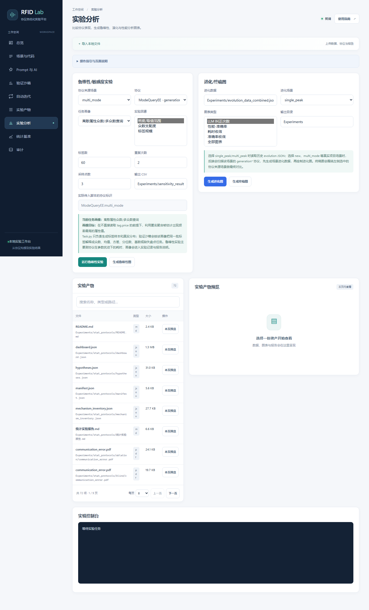

上方设置来源场景、协议、任务画像和采样参数，可以运行鲁棒性实验、生成鲁棒性图、进化图或终稿图。实验结束后刷新产物列表，控制台显示命令、返回码和输出。

下方的实验资产列表支持搜索和分页；点击“本页预览”查看图表、CSV、JSON 或报告。`Experiments/` 下的嵌套产物也会被扫描。

### 3.8 统计基准

“统计基准”是统计协议与算法实验的可视化入口。页面支持按主实验/消融实验、任务、数据分布和标签规模筛选，展示通信量—误差散点图、协议成功率、reader/tag bits、slots、frames、rounds 和失败数量。


新增六组实验：主实验、共享/复核消融、H1三任务共享、H2复核与阈值敏感性、缺失/噪声/极端值、独立盲测。正式规格为20个seed、5个分布、1k/10k/100k；图中可切换bits/slots/rounds，点击协议名或图点可查看分页的逐seed真值、估计值、数据hash、轮次轨迹和失败原因。单场景展示95%CI，跨场景汇总明确标为描述性平均。

页面的“主图与原始资产”会列出当前实验集的 JSON、CSV、PNG 和 PDF，点击资产名称即可在页面内预览；点击协议行或图点可展开分页的逐 seed 结果。验收清单、交付证据、机制基因表和复现命令集中在本 README 下文。

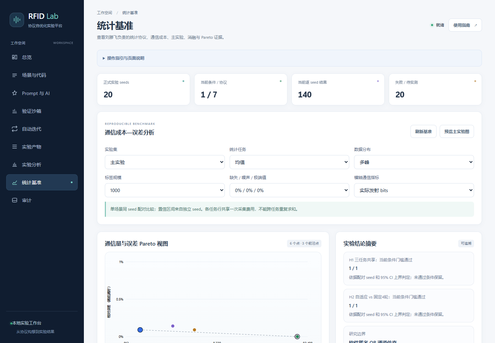

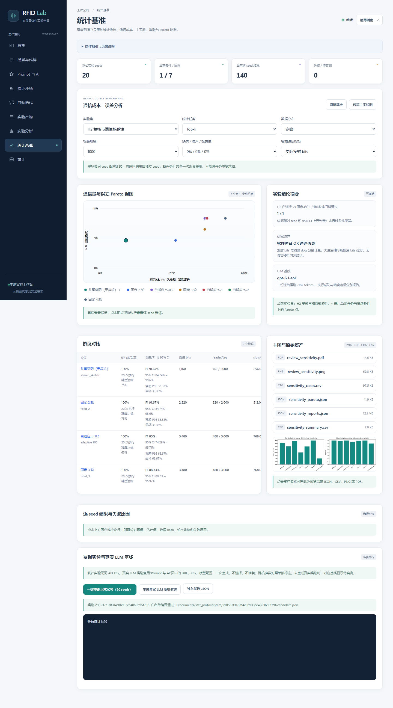

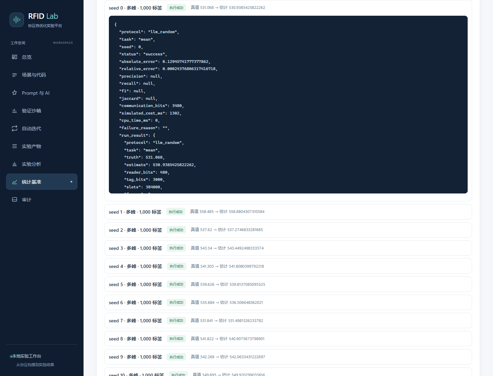

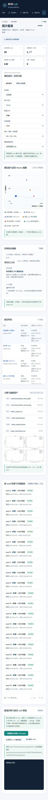

直接访问：<http://127.0.0.1:8765/#statistics>。

详细的[统计实验交付验收与演示](docs/统计实验交付验收.md)、[统计实验规格v1](docs/统计实验规格v1.md)、[自动算法与实验报告](code_add/Experiments/stat_protocols/统计实验报告.md)均已提供。软件模型的bits优势与预留slots代价同时报告；未达到H1/H2门槛的条件保留。

点击“一键重跑正式实验”将在后台子进程生成整套结果，成功后发布新结果；不阻塞页面。真实LLM基线复用“Prompt与AI”的URL、Key和模型，点击“生成真实LLM随机候选”后再重跑，或者导入候选JSON。没有实际候选时显示待实测并保留失败原因，随机参数组不会冒充模型结果。网关未返回token用量时记为未知，不写0成本。

当前交付已包含Pixel真实调用：gpt-6.1-sol，一次生成用量187 tokens。主实验中四任务各300条执行成功；Top-k平均F1为0.6811，完整匹配达标率35.67%，精度不足的结果全部保留。提示词、响应和候选证据通过下方 README 文件链接查看；网页保留候选状态并在统计摘要中显示模型信息。20个seed是同一候选的数据评价，不是20次模型生成；复现已保存候选无需密钥或再次调用模型。

#### 3.8.1 统计实验验收

当前交付共9项完成、1项待扩展验证。“完成”指代码与软件实验有可复现证据，不表示所有研究假设达到门槛；完整验收口径见[统计实验交付验收](docs/统计实验交付验收.md)。

| 文档要求 | 状态 | 交付证据与边界 |
| --- | --- | --- |
| §5.3.1 / W1：历史协议机制基因表 | 已完成 | 143个世代文件索引、6类机制；源文件、行号与SHA-256可追溯 |
| §5.3.2 / W3–4：共享采集与四任务 | 已完成 | `run_many`一次采集；均值、方差、在场标签数、Top-k共享`collection_id`，费用不跨任务重复相加 |
| §5.3.3 / W2：通信成本模型 | 已完成软件模型 | 每帧广播、标签响应和预留空槽逐事件计数；保留reader/tag bits、slots、frames、rounds；无硬件时延结论 |
| §5.3.4：Polling / 全识别 / 单任务基线 | 已完成 | 全识别为无碰撞乐观下界；单任务串联作为无共享消融 |
| §5.3.4：真实LLM随机生成基线 | 已实测 | gpt-6.1-sol真实网关响应；一份冻结候选跨数据seed评价，保留Prompt/响应/候选记录 |
| W6：固定 / 自适应复核与阈值 | 已完成 | 1/2/3/4帧、阈值0.5/1/2；逐seed配对H2，未达标结果保留；当前采用全帧复核 |
| W7–8：规模、缺失、长尾和正式实验 | 已完成 | 20个seed、5分布、三个规模；缺失/噪声/极端值、独立盲测、95%CI/P95/最坏值 |
| §5.3.5 / W8：主实验、消融与Pareto图 | 已完成 | 同任务内计算Pareto；失败或不可用候选排除出前沿，并保留原始失败记录 |
| W9–10：算法章节、图表校对、交付 | 已完成 | 自动报告、机制表、H1/H2验收、复现命令、原始CSV/JSON及PNG/PDF |
| 扩展验证接口 | 待扩展验证 | 演化选择、运行时沙箱和物理隔离不包含在本统计基准中；已提供白名单编译器和评价接口 |

#### 3.8.2 交付文件与真实模型证据

| 文件 | 用途 |
| --- | --- |
| [hypotheses.json](code_add/Experiments/stat_protocols/hypotheses.json) | H1/H2逐条件结果、配对统计及未达标条件 |
| [manifest.json](code_add/Experiments/stat_protocols/manifest.json) | 执行环境、源码SHA-256、实验规格、真实候选与运行行数 |
| [mechanism_inventory.json](code_add/Experiments/stat_protocols/mechanism_inventory.json) | 历史机制、世代文件索引与完整hash |
| [实验目录README](code_add/Experiments/stat_protocols/README.md) | 六组实验的文件导航与结果口径 |
| [统计实验报告](code_add/Experiments/stat_protocols/统计实验报告.md) | 算法、成本模型、实验观察与局限 |
| [LLM · candidate.json](code_add/Experiments/stat_protocols/llm/290537f3a8314c0b933ce4063b95f79f/candidate.json) | 真实候选参数、模型、usage、Prompt/响应hash |
| [LLM · prompt.txt](code_add/Experiments/stat_protocols/llm/290537f3a8314c0b933ce4063b95f79f/prompt.txt) | 实际发送的提示词 |
| [LLM · response.txt](code_add/Experiments/stat_protocols/llm/290537f3a8314c0b933ce4063b95f79f/response.txt) | 模型原始响应 |

#### 3.8.3 历史协议机制基因表

当前交付索引143个历史世代文件；关键词只用于定位，不构成正确性或隐私证明。完整文件hash和`tracked`标记见上方机制索引文件。

| 机制 | 来源 | 复用决策 |
| --- | --- | --- |
| 逐值精确计数与静默 | [ModeQueryEE.py:48](code_add/base_protocol/ModeQueryEE.py#L48) | 保留历史计数机制，不将原自报时间带入新基准 |
| 全识别 | [ModeQueryID.py:7](code_add/base_protocol/ModeQueryID.py#L7) | 新基准明确采用无碰撞乐观下界 |
| SEM位平面并行与零槽估计 | [ModeQuerySEM.py:68](code_add/base_protocol/ModeQuerySEM.py#L68) | 复用匿名占用位图与零槽反演；逐事件记录发射bits和预留slots |
| 碰撞/占用利用 | [ModeQueryTCS.py:55](code_add/base_protocol/ModeQueryTCS.py#L55) | 从非空槽排序扩展为有限帧计数反演；保留桶饱和等负结果 |
| SOG与多轮融合 | [ModeQueryTKQ.py:22](code_add/base_protocol/ModeQueryTKQ.py#L22) | 复用多轮独立测量思想，未声称实现SOG硬件 |
| 早停、置信差与候选复核 | [test_g3_1.py:124](code_add/test/generation_3/test_g3_1.py#L124) | 复用不确定性驱动思想；当前采用全帧复核，定向单值复核留作扩展 |

#### 3.8.4 复现实验命令

在仓库根目录打开终端，运行以下命令可复现已保存真实候选的正式实验，不会再次调用模型：

```powershell
cd code_add
python -m benchmark.suite --llm-candidate Experiments/stat_protocols/llm/290537f3a8314c0b933ce4063b95f79f/candidate.json --output-dir Experiments/stat_protocols
```

### 3.9 审计

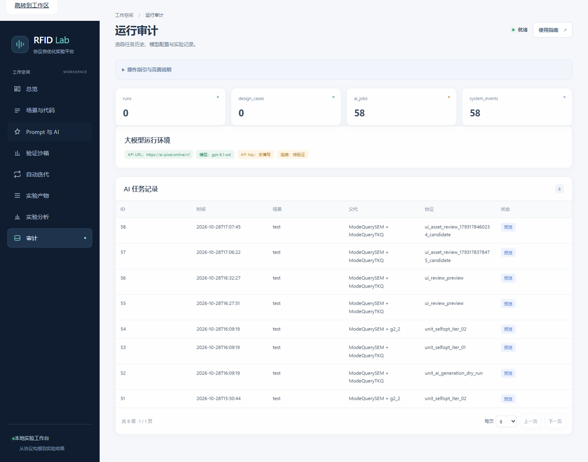

查看 SQLite 中的运行统计、模型环境配置状态和最近 AI 任务记录。`预览` 表示只生成了 Prompt；实际生成任务需结合状态和协议文件判断结果。

审计数据在本机持久化，后台任务队列保存在服务进程内；重启服务后，原后台队列不能继续执行或轮询。

## 4. 手动上传本地文件

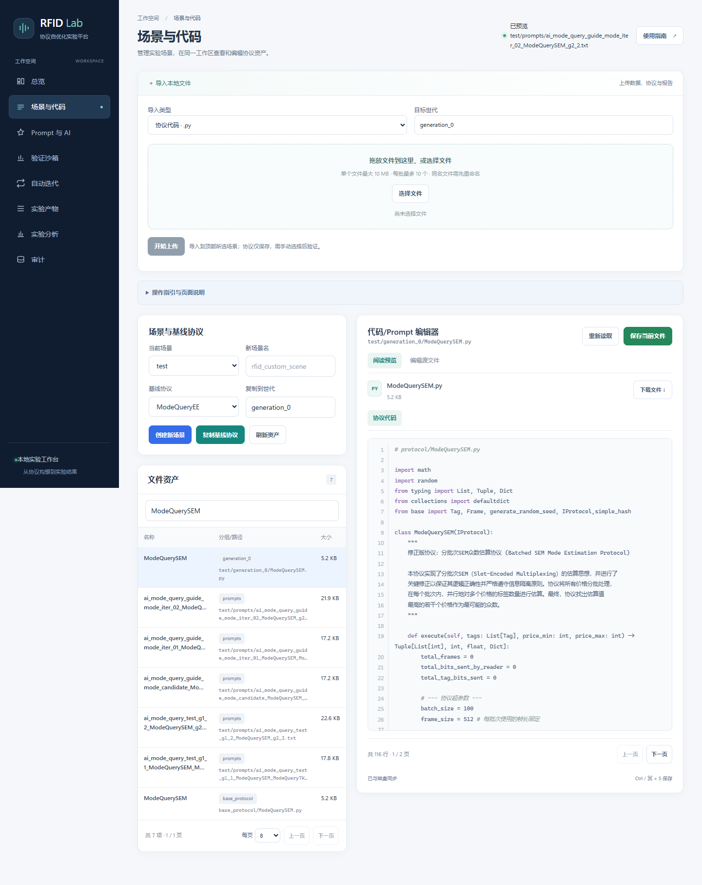

“场景与代码”“实验产物”“实验分析”页面顶部均有“导入本地文件”。展开后选择文件或拖放到上传区，点击“开始上传”。

| 页面 / 导入类型 | 保存位置 | 文件要求 |
| --- | --- | --- |
| 场景与代码 / 协议 | 当前场景指定的 `generation*` 目录 | `.py`，名称由英文字母、数字、下划线组成，不能以数字开头 |
| 场景与代码 / Prompt | 当前场景 `prompts/` | `.txt` |
| 场景与代码 / 场景输出 | 当前场景 `outputs/uploads/` | 支持的数据、文本、图片或报告 |
| 实验产物 | `code_add/course_project/outputs/uploads/` | CSV、JSON、MD、TXT、LOG、HTML、PDF、PNG、JPG、JPEG、WebP、SVG |
| 实验分析 | `code_add/Experiments/uploads/` | 同上 |

每个文件最多 **10 MB**，每批最多 **10 个**；文本需使用 **UTF-8** 编码，JSON 需符合格式。同名文件会拒绝覆盖，需重命名后重传。导入协议仅保存文件，后续运行由验证或实验操作触发。

## 5. 手机与窄屏

窄屏自动切换为单列工作区，顶部导航可横向滚动。宽数据表在自己的容器中滚动，文件列表和长文本通过分页查看。

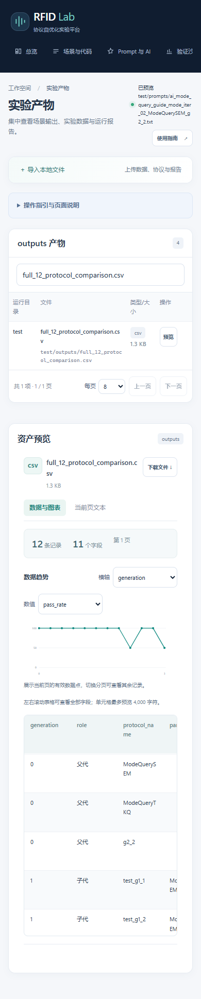

## 6. 项目文件架构

下图省略大部分历史协议和数据文件；`uploads/`、运行数据库等目录或文件按需生成。

```text
rfid/
├─ README.md                         # 本图文操作指南
├─ .gitignore                        # 忽略虚拟环境、缓存、数据库和本地密钥
├─ docs/
│  ├─ screenshots/                   # 10 个工作区与上传截图、4 个当前统计基准视图
│  ├─ 统计实验交付验收.md           # 逐项对照与3分钟演示
│  └─ 统计实验规格v1.md               # 指标、成本、假设与共同接口口径
├─ code_add/                         # 应用工作目录
│  ├─ README.md                      # 项目简介与启动说明
│  ├─ base.py                        # Tag / 协议基础接口
│  ├─ Validator.py                   # 物理约束等协议检查
│  ├─ Test.py                        # 命令行批量测试
│  ├─ prompt_generation.py           # 父代协议读取与 Prompt 构造
│  ├─ ai_protocol_optimizer.py       # 模型生成、修复与协议落盘
│  ├─ backend_tools/
│  │  ├─ openai_compatible.py        # 模型 HTTP 客户端
│  │  └─ protocol_metrics.py         # 协议指标归一化
│  ├─ stat_protocols/                # 四任务共享草图、匿名通道、基线与成本契约
│  ├─ benchmark/                     # 正式/消融/复核/鲁棒/盲测与一键suite
│  ├─ course_project/
│  │  ├─ README.md                   # API、实现和运行约定
│  │  ├─ web_app.py                  # HTTP 路由与工作流编排
│  │  ├─ http_support.py             # 请求/响应边界与统一错误
│  │  ├─ validation.py               # 数值范围与布尔参数校验
│  │  ├─ jobs.py                     # 有界后台队列与进度快照
│  │  ├─ assets.py                   # 上传校验、有界文本与数据预览
│  │  ├─ statistics_service.py       # 统计查询、真实LLM候选、子进程实验发布
│  │  ├─ database.py                 # SQLite 审计与任务记录
│  │  ├─ selfopt_ui.py               # HTML 导出兼容入口
│  │  ├─ test_course_project.py       # 核心工作流测试
│  │  ├─ test_infrastructure.py       # HTTP、上传、编辑与任务边界测试
│  │  ├─ static/
│  │  │  ├─ index.html               # 页面结构
│  │  │  ├─ app.css                  # 工作台视觉样式
│  │  │  ├─ app.js                   # 场景、生成、验证、实验交互
│  │  │  ├─ assets.css               # 资产预览和响应式细节
│  │  │  ├─ statistics.js            # 统计/Pareto交互、逐seed证据与基线入口
│  │  │  └─ asset_ui.js              # 分页、分类预览和上传组件
│  │  └─ outputs/                    # 平台运行产物与 uploads/
│  ├─ base_protocol/                # 可复用基础协议
│  ├─ test/                         # 推荐先体验的测试场景
│  │  ├─ Task.py                    # 场景标签生成
│  │  ├─ generation_0/              # 父代协议
│  │  ├─ generation_1/ ...          # 后续世代协议
│  │  ├─ prompts/                   # 生成或导入的 Prompt
│  │  └─ outputs/                   # 对比数据与运行结果
│  ├─ ManyTags/                     # 多标签场景
│  ├─ multi_mode/                   # 多众数场景
│  ├─ single_mode/                  # 单众数场景
│  ├─ rfid_mode_finding_v1/          # 历史场景
│  ├─ ss/                           # 历史场景
│  └─ Experiments/                  # 鲁棒性实验、绘图脚本与结果
├─ 周报1.pdf                         # 既有项目资料
└─ 用户手册3.docx                    # 既有项目资料
```

请求从 `web_app.py` 进入，经参数校验后调度资产、协议或实验逻辑；AI/迭代任务由 `jobs.py` 管理，历史写入 SQLite。前端通过 HTTP API 读取状态和资产，代码不需要打包编译。

更完整的接口和运行约定见 [开发说明](code_add/course_project/README.md)。当前服务面向本机实验使用，协议执行还没有容器级隔离。

## 7. 本地检查

在 `code_add` 目录运行：

```powershell
python -m unittest course_project.test_infrastructure course_project.test_course_project
```

使用上述虚拟环境时，将 `python` 替换为 `..\.venv\Scripts\python.exe`。测试覆盖上传、预览分页、下载、文件冲突、参数验证、后台队列和核心工作流。模型配置与接口自动识别检查见下方命令；测试使用本地模拟网关，不会调用付费模型。

```powershell
python -m unittest course_project.test_ai_configuration
```

统计协议与Web统计服务的完整回归：

```powershell
python -m unittest course_project.test_statistics_service course_project.test_stat_protocols course_project.test_ai_configuration course_project.test_infrastructure course_project.test_course_project -q
```
