# RFID Lab · 大模型驱动的 RFID 协议自优化研究平台

围绕“描述任务 → 生成候选 → 受控验证 → 演化选择 → 冻结评测 → 追溯结果”，将 RFID 协议研究、统计实验和资产管理集中到一个 Web 工作台中。当前前端为 **Vue 3 + TypeScript + Vite**，后端为 **Python HTTP 服务 + SQLite**，提供 11 个功能页面。

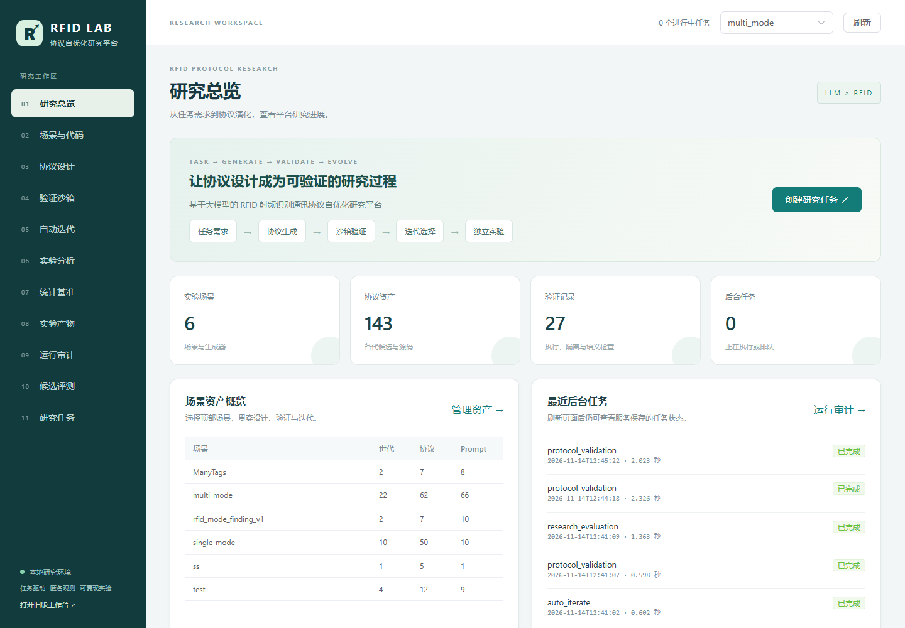

## 项目信息

以下信息沿用 2026 年 11 月提供的结题报告版本；软件功能、页面入口、测试与实验结论按当前仓库核对。

| 项目 | 内容 |
| --- | --- |
| 项目名称 | 基于大模型的RFID射频识别通讯协议自优化研究平台开发 |
| 项目编号 | S202610486321 |
| 学校 / 学院 | 武汉大学 / 计算机学院 |
| 专业 | 软件工程 |
| 团队成员 | 陈涛、严枭、刘滕飞 |
| 指导教师 | 朱卫平 教授 |
| 材料核对日期 | 2026-11-14 |

[结题报告 Word 版](docs/reports/大学生创新创业训练项目结题报告.docx) · [结题报告 PDF 版](docs/reports/大学生创新创业训练项目结题报告.pdf) · [版本与材料核对说明](docs/reports/README.md) · [本次验证记录](docs/verification/2026-11-14.json)

平台已经实现自然语言任务输入、模型即时配置、严格子进程验证、预算控制、Pareto 选择、候选冻结和独立评测。研究结果属于声明的软件信道与统计契约；模拟通信成本、程序执行成功、统计精度和真实射频硬件性能分别报告。

## 快速启动

### 首次安装

准备 Python、Node.js 和现代浏览器。前端 `package.json` 要求 **Node.js 20.x ≥ 20.19，或 ≥ 22.12**；构建完成后由 Python 提供页面，日常运行无需另起 Node 服务。

在 PowerShell 中执行：

```powershell
git clone https://github.com/aozakiko/rfid.git
Set-Location .\rfid

# 安装仓库声明的 Python 依赖，不需要激活虚拟环境。
python -m venv .venv
.\.venv\Scripts\python.exe -m pip install -r requirements.txt

# 安装锁文件中的前端依赖，执行 TypeScript 检查和生产构建。
Set-Location .\code_add\course_project\frontend
npm ci
npm run build

# 回到 code_add 启动 Python 服务。
Set-Location ..\..
..\.venv\Scripts\python.exe -m course_project.web_app --host 127.0.0.1 --port 8765
```

浏览器访问 **http://127.0.0.1:8765**，在启动服务的终端按 `Ctrl+C` 停止。

> 新机器必须先构建前端。`dist/` 和 `node_modules/` 不提交 Git；缺少 `dist/` 时根路径会显示兼容工作台，容易误以为页面没有更新。新版也可从 `/ui/` 进入，旧版保留在 `/legacy`。本 README 的截图和操作均对应新版。

### 已有项目更新

先妥善保存本地修改，再在仓库根目录执行：

```powershell
git pull --ff-only
Set-Location .\code_add\course_project\frontend
npm ci
npm run build
Set-Location ..\..
..\.venv\Scripts\python.exe -m course_project.web_app --host 127.0.0.1 --port 8765
```

若旧服务仍占用 8765，先在其终端按 `Ctrl+C`。Python 源码更新后需重启后端；仅修改页面中的模型 URL、Key 或模型名时，下一次提交立即使用新配置。

本次完整检查的实际环境为 Windows、Python 3.13.5、NumPy 2.4.2、pandas 3.0.0、Matplotlib 3.10.8、Node.js 22.16.0 和 Microsoft Edge。**该数值依赖组合高于 `requirements.txt` 的上限**，已单独记录，不代表所有依赖组合均已验证。首次安装以仓库依赖范围为准，精确复现本次记录时对照[验证文件](docs/verification/2026-11-14.json)。

## 先走通一个不调用模型的流程

1. 在顶部场景框选择 `test`，打开“场景与代码”，查看 `Task.py` 和 `MeasuredHistogramMean` 等协议。
2. 打开“协议设计”，选择任务画像和两个不同父代，点击“预览生成任务”，检查 Prompt 与目标路径。
3. 打开“验证沙箱”，选择“连续数值均值估计”和 `MeasuredHistogramMean`，使用较小标签规模运行严格验证，查看阶段结果和历史。
4. 打开“研究任务”，创建任务并保存配置版本，选择初始基线，分别执行冻结候选验证和小规模跨场景评测。
5. 在“候选评测”查看验证 / 盲测拆分、同场景对照和运行证据，在“实验产物”预览 CSV、JSON 和报告。
6. 确认流程后，再配置模型、实际生成候选或启动多轮优化。

预览只产生 Prompt 与计划路径，不调用模型，也不创建候选 `.py` 源码。冻结基线的小规模评测可以执行真实后端流程，无需付费模型。

## 页面导航与操作

所有地址均接在 `http://127.0.0.1:8765` 后面。`test`、`multi_mode` 等是**场景目录**；“任务画像”决定本次任务、输出契约和验证语义，二者可以分别选择。

| 页面 | 地址 | 核心用途 |
| --- | --- | --- |
| 研究总览 | `/#/` | 项目资产概况、世代分布和工作流入口 |
| 场景与代码 | `/#/assets` | 场景管理、源码编辑、版本校验和文件导入 |
| 协议设计 | `/#/design` | 模型配置、任务描述、Prompt 与单次候选生成 |
| 验证沙箱 | `/#/validation` | 严格 / 兼容验证、阶段证据和验证历史 |
| 自动迭代 | `/#/optimization` | 父代池、通信优化、Pareto 多样性、预算与停止条件 |
| 实验分析 | `/#/experiments` | 配置实验、盲测流水线、结果重建与绘图 |
| 统计基准 | `/#/statistics` | 同场景比较、置信区间、Pareto 与逐 seed 结果 |
| 实验产物 | `/#/artifacts` | 文件搜索、分类预览、分页与原件下载 |
| 运行审计 | `/#/audit` | 持久任务历史、取消 / 重试、验证记录和候选来源 |
| 候选评测 | `/#/research` | 冻结版本、跨分布 / 规模 / 扰动的独立评测 |
| 研究任务 | `/#/workspaces` | 配置版本、初始基线和完整研究运行记录 |

### 研究总览

总览展示当前场景、协议、Prompt、任务和实验资产，提供后续工作流入口。首页截图见文首。文件数量与运行统计由本机资产生成，会随使用变化。

### 场景与代码：编辑与导入

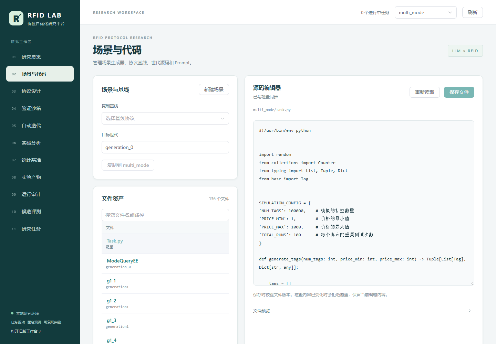

选择场景后可新建场景、复制基线、搜索文件和编辑源码。保存携带读取时的 SHA-256 `revision`；磁盘文件已改变时返回 409，保留编辑缓冲，重新读取并核对后再保存。编辑器支持 `Ctrl/⌘+S` 和未保存提示。

文件导入集中在本页，可选择场景协议、Prompt、场景 Outputs、平台运行产物或 Experiments 产物。


| 保存位置 | 用途 |
| --- | --- |
| 场景协议 | 将 `.py` 文件保存到所选场景的指定世代 |
| 场景 Prompt | 将 `.txt` 保存到场景 `prompts/` |
| 场景 Outputs | 保存到场景 `outputs/uploads/` |
| 运行产物 | 保存到 `course_project/outputs/uploads/` |
| Experiments 产物 | 保存到 `Experiments/uploads/` |

每个文件最多 10 MB；文本采用 UTF-8，JSON 上传时校验格式，同名文件返回 409。导入协议仅保存资产，需在验证页手动选择并运行。

### 协议设计：任务与单次生成

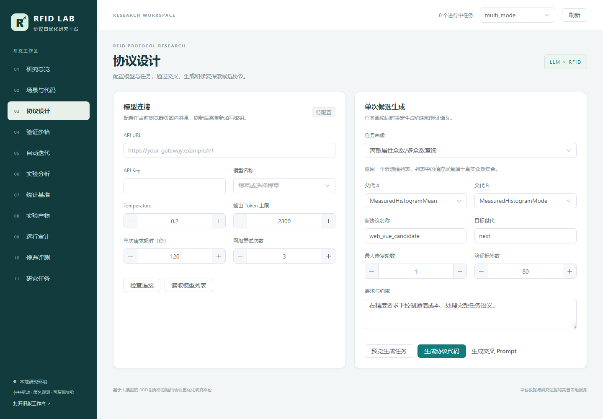

选择任务画像、两个不同父代、新协议名和目标世代，可补充需求、设置修复轮数与验证规模。通过“预览生成任务”先核对 Prompt，再按需点击“生成协议代码”。后台面板展示排队、模型请求、验证、自修复和完成状态，完成后可预览产物并衔接候选冻结。

选择“任意自定义任务”后会出现专用说明框：

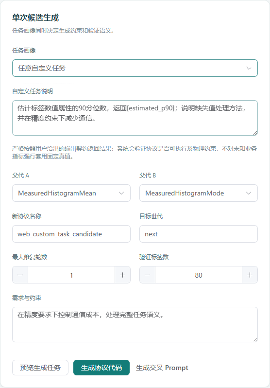

建议说明输入属性、目标、返回格式、误差要求及资源约束，例如：

```text
估计标签数值属性的 90 分位数，返回 [estimated_p90]；
描述对缺失数据的处理方法，并在保证精度的前提下减少通信。
```

自定义说明会进入 Prompt 和运行记录。内置统计任务具有对应真值与指标；任意业务尚无专用评价器时，平台只验证执行与输出契约，不生成虚假的准确率。要对新业务给出可比较的精度，应补充任务注册、真值和评价逻辑，入口见 [`generic_tasks/`](code_add/generic_tasks/) 与 [`generic_protocol/`](code_add/generic_protocol/)。

### 验证沙箱：阶段判定与历史

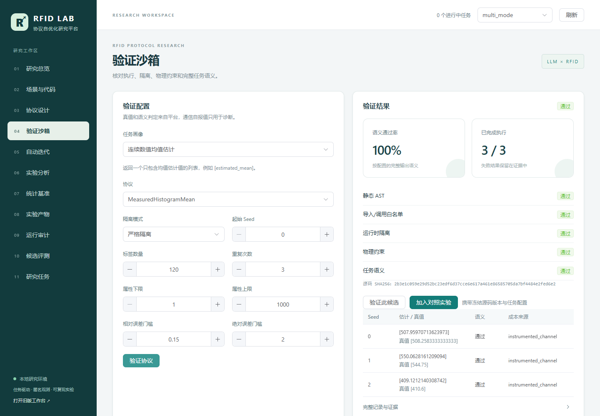

选择协议或冻结候选、任务画像、标签数量、重复次数和值域，运行后分别查看静态检查、运行时隔离、物理约束和任务语义。结果区展示逐次执行、质量与耗时，历史记录保存源码摘要及阶段证据。

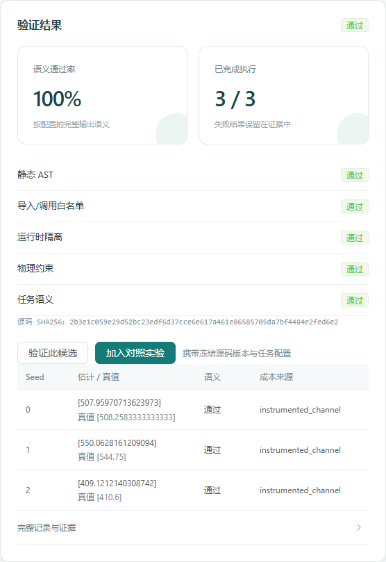

严格模式使用独立子进程、AST 与调用限制、标签访问代理、运行时审计、超时及资源限制。兼容模式可运行历史协议并展示直接标签访问等告警。两种模式的状态分别标识；严格验证属于软件约束，不能当作完整操作系统沙箱或硬件隐私证明。

### 自动迭代：目标、预算与选择证据

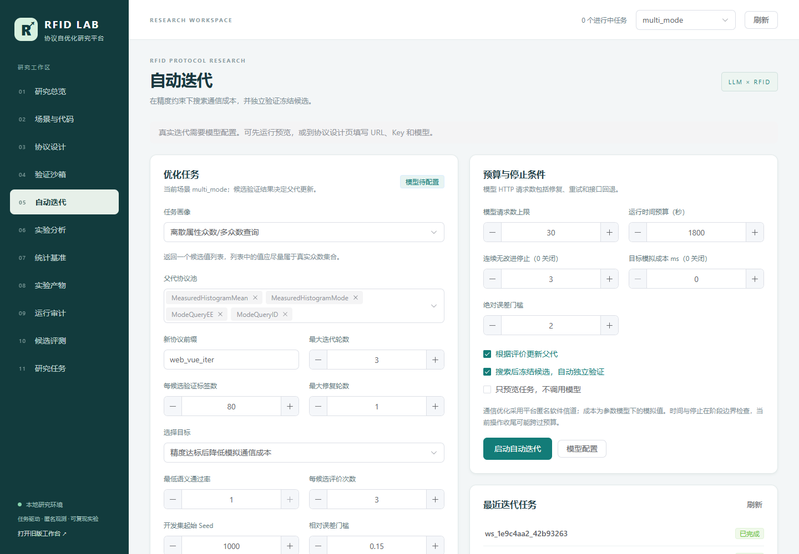

配置父代池、开发集、质量门槛、轮数、最大请求数和时间预算，可选择：

| 选择目标 | 行为 |
| --- | --- |
| `quality_only` | 质量探索 |
| `precision_constrained_cost` | 在精度要求下比较平台计量通信成本 |
| `pareto_diversity` | 对通过率、质量与成本分层，以拥挤度保留多样性，并进行 AST 结构去重 |

每轮保存候选、保留 / 排除原因、实际请求数、耗时和停止原因。独立验证在搜索结束后冻结赢家与初始基线，并检查验证数据重叠。先使用预览模式核对父代与 Prompt，再按需真实运行；预览结果不代表已完成模型优化。

### 研究任务：保存一条完整研究流程

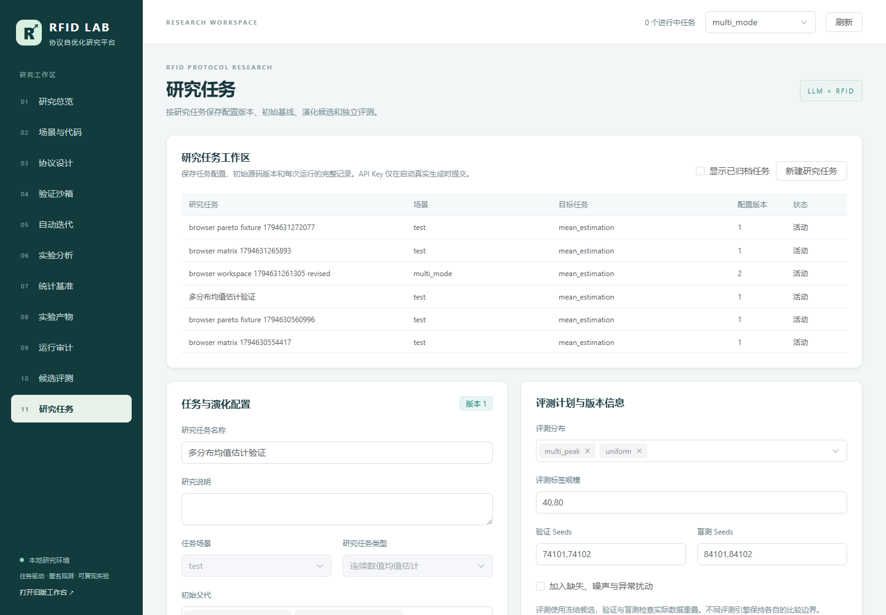

创建任务并选择初始基线、演化父代、目标与评测计划；每次保存产生配置版本。演化、验证和评测分别形成独立运行 ID，关联同一任务，刷新后可恢复已保存状态。旧版本提交返回 409，避免把不同配置的结果混在一起。

截图示例使用冻结基线完成了真实严格验证与 16 条小规模评价，用于展示流程；它不是一次真实 LLM 优化收益实验。模型元信息可以保存，API Key 不进入任务配置。

### 候选评测：冻结后再独立比较

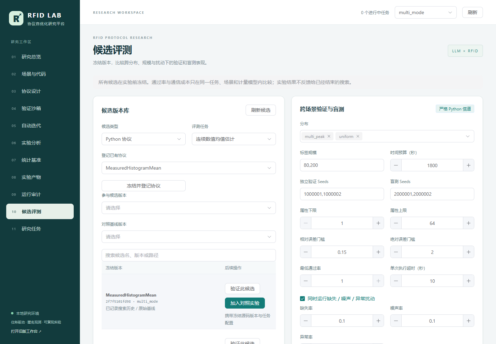

从已有协议、生成结果或统计 JSON 候选冻结版本，确定基线、分布、规模、扰动、验证 seed 和盲测 seed，再提交评测。Python 候选与统计 JSON 按各自能力进入对应引擎；成本模型不同的结果不跨引擎排名。

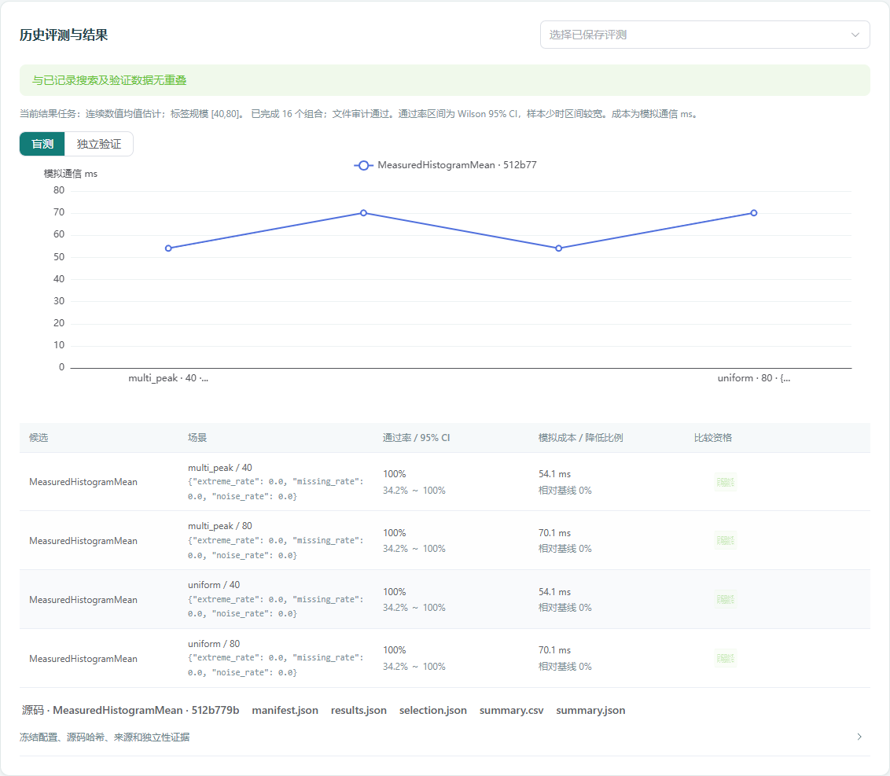

结果保留验证 / 盲测切换、同场景比较、候选源码摘要、独立性检查和清单下载。运行成功与质量达标分别报告，缺少可信通信事件的候选不能以零成本进入通信前沿。

### 实验分析：配置、流水线与绘图

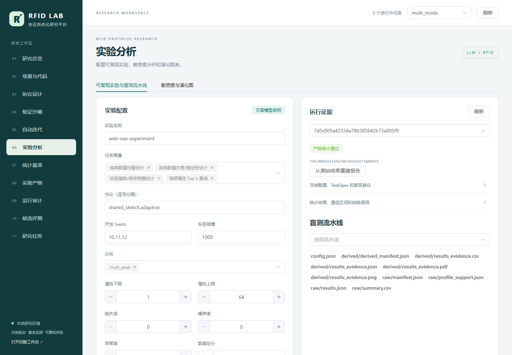

选择配置或输入实验参数，可以提交配置化 benchmark、开发—验证—冻结—盲测流水线，或从原始结果重建派生报告。页面同时提供原项目敏感度与演化绘图入口。后台显示命令进度、输出与失败原因；结果重建写入派生目录，保留原始评价数据。

### 统计基准：同条件比较与逐次证据

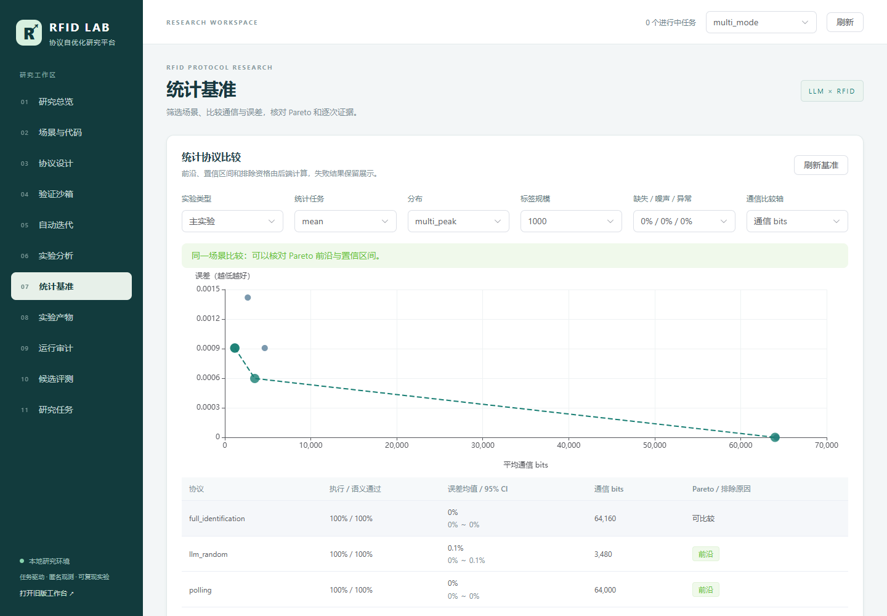

按实验集、任务、分布、标签规模、扰动及通信指标筛选。前沿、资格、排除原因和置信区间由后端计算；同场景结果可直接比较，跨场景汇总只作为描述性平均。点击协议或图点查看逐 seed 真值、估计、数据 hash、复核轨迹及失败原因。

六组统计实验分别为主实验、消融、三任务共享、复核敏感性、鲁棒性和独立盲测。真实模型候选可查看记录或另行生成 / 导入。完整实验规格、数值与边界见后文。

### 实验产物：每种文件使用合适的预览

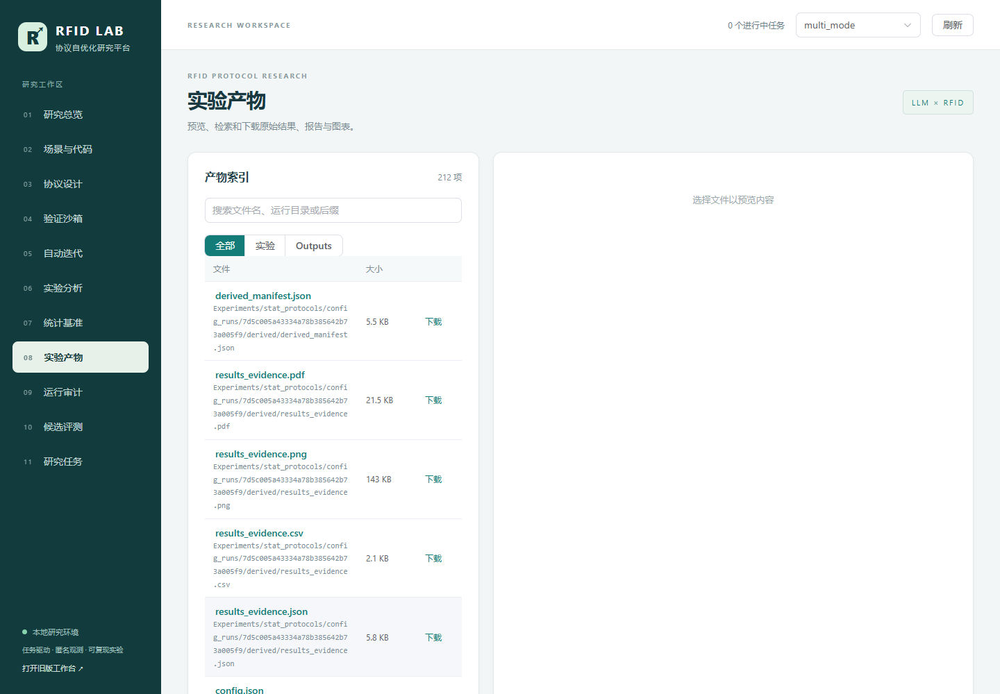

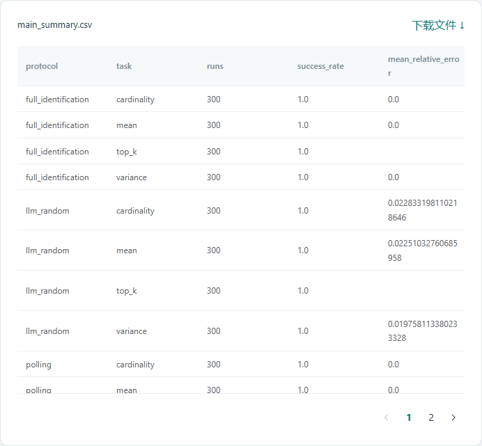

| 文件类型 | 当前展示方式 |
| --- | --- |
| CSV | 每页 20 条、表头与单元格、宽表在容器内滚动 |
| JSON | 可展开结构；大于 1 MB 时使用分页文本 |
| Python / Prompt / Markdown / 日志等文本 | 等宽文本，长文件按每页 100 行阅读 |
| PNG / JPG / WebP / SVG | 图片预览并适应容器 |
| HTML / PDF | 受限 iframe 内嵌预览 |
| 过大文本或其他文件 | 下载原件查看 |

产物列表提供搜索与分页，所有允许访问的资产均可下载原件。原始 JSON 报告过大时，在“统计基准”使用逐次详情入口，避免一次展开整个报告。

### 运行审计：状态、停止与重试

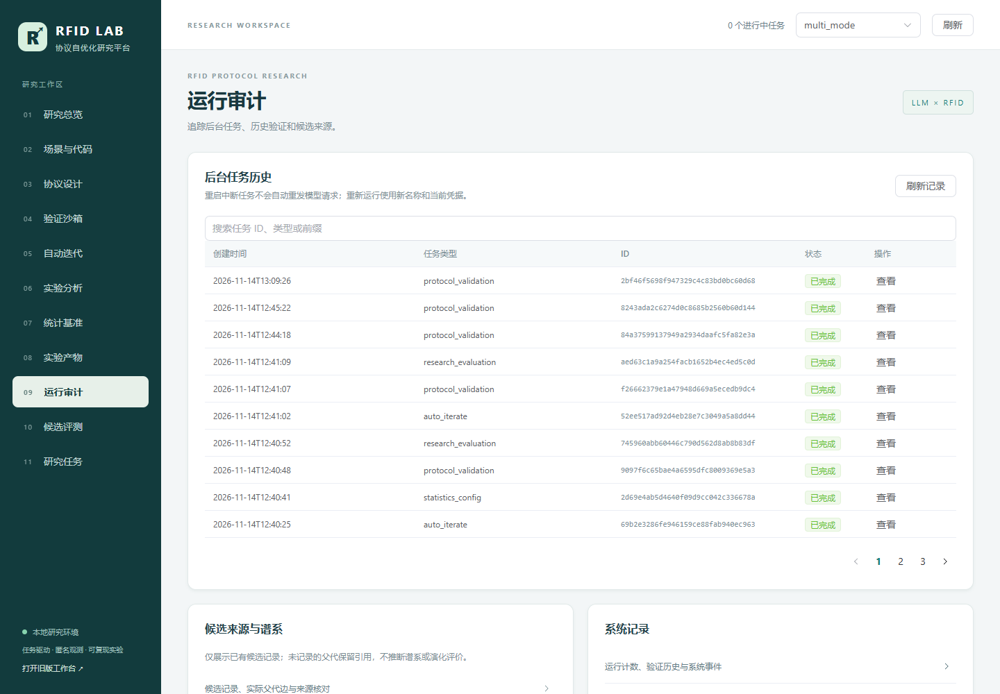

后台任务支持历史查询、取消和重试。任务历史、验证报告和候选来源持久化；服务重启后，原进程中未完成任务标记为 `interrupted`，通过新名称重试，不能从中断的模型响应继续计算。切换页面不取消任务，刷新后从服务端历史恢复展示。

### 移动端

11 个页面均按 390×844 视口检查。表单收为单列、宽表在自身容器滚动，文件与长文本通过分页查看。

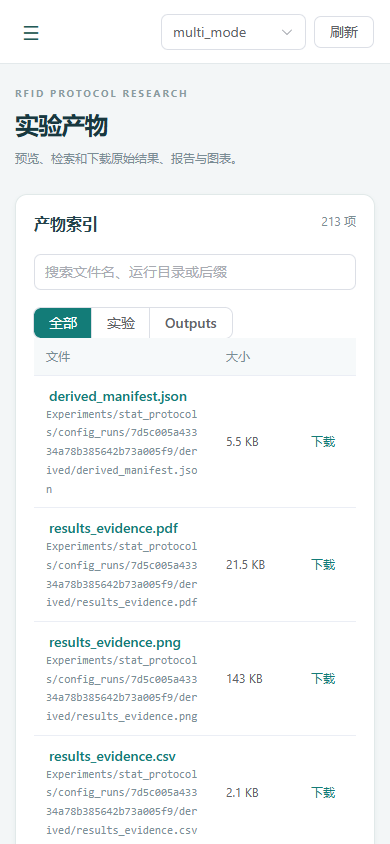 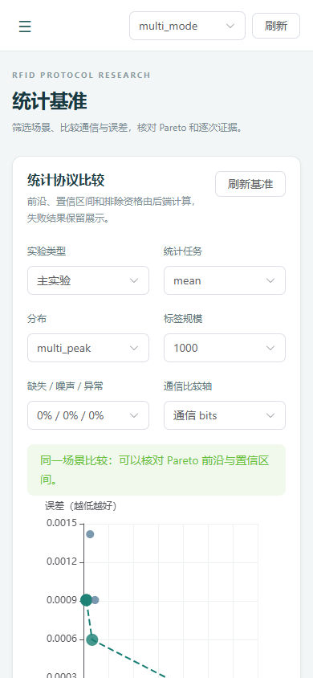

截图拍摄于 2026-11-14，同一生产构建、后端源码与 Vue 页面版本；等待数据加载完成后拍摄，没有改写页面数据。各图的路由、视口和 SHA-256 见[截图清单](docs/screenshots/vue/manifest.json)。旧工作台截图仍在历史目录中，本 README 不混用旧图。

## 模型配置：直接使用 URL、Key 和模型名称

在“协议设计”填写：

| 设置 | 说明 |
| --- | --- |
| API URL | 网关提供的基础地址，例如 `https://your-gateway.example/v1` |
| API Key | 对应网关的密钥 |
| 模型名称 | 网关实际支持的模型标识 |
| 超时 / 重试 / 生成参数 | 按需设置，长响应可能需要较长等待 |

不需要模型环境变量，也不需要 Endpoint Path。客户端先尝试 Responses，遇到接口不支持的状态时尝试 Chat Completions；鉴权失败、限流或网络故障不作为更换接口的依据。可先点击模型检查或列出模型，再提交真实生成。

修改后，下一次检查、生成或迭代使用新配置，无需重启；已经提交的任务继续使用提交时的配置。Key 在当前页面内存和活动请求 / 后台任务内使用，不写入配置文件、浏览器持久存储或公开任务历史；刷新页面后需重新填写。

日志停在“正在请求大模型”可能仍在等待上游完整响应。先检查任务状态与超时设置，避免连续重复提交。预览、冻结基线评测和复现已有模型候选均不需要密钥。

## 算法、实验与结论口径

### 已实现的方法

- **统一任务契约**：任务画像、输入范围、真值、输出语义、误差阈值、数据拆分与运行结果保持明确边界。
- **共享统计草图**：在公开整数值域上通过匿名 OR 槽测量和零槽反演构造直方图，同次采集复用到均值、总体方差、在场标签基数和 Top-k。
- **通信事件计量**：分别记录 reader bits、tag bits、全部预留 slots、frames 和 rounds；CPU 时间单列。
- **复核策略**：无复核、固定 2/3/4 轮，以及阈值 0.5/1/2 的全帧自适应复核。
- **闭环搜索与评价**：候选生成、自修复、严格验证、精度约束 / Pareto 选择、结构去重和冻结后的独立评测。

共享任务行可能来自同一个 `collection_id`，采集费用只计一次，不能按任务行数重复求和。饱和桶的零槽截断带来偏差，当前实现未提供无偏性或完整隐私保证。

### 六组正式实验

基本设置为 20 个数据 seed、5 类分布、1000 / 10000 / 100000 标签、公开整数值域 1..1000，Top-k 默认 k=3；盲测使用独立 seed 100..119。鲁棒性与盲测各有单独的分布 / 扰动组合，不等同于全部分布的笛卡尔积。

| 实验集 | 目的 | 任务评价行 |
| --- | --- | ---: |
| `main` | 基线、共享、随机参数控制组与真实模型单次候选 | 8400 |
| `ablation` | 去共享、无复核、固定 / 自适应复核 | 8400 |
| `composite` | H1：均值、方差和在场基数共享采集 | 1800 |
| `sensitivity` | H2：复核轮次和阈值 | 8400 |
| `robustness` | 两类分布、三个规模、四类扰动 | 9600 |
| `blind` | 独立数据与组合扰动 | 1440 |
| **合计** | **任务评价记录，不是独立采集数或模型调用数** | **38040** |

每个可比较的“协议×任务”在主实验中通常有 300 条评价，即 20 seeds × 5 分布 × 3 规模。单场景提供 95% CI、P95、最坏值与失败记录，跨场景总体均值仅作描述性汇总。

### 关键结果与未达标条件

| 项目 | 可核查结果 | 解释 |
| --- | --- | --- |
| 三任务共享费用 | 平均 37,160 bits，对照串联 111,480 bits，节省 2/3 | 相同测量原语与软件计费下的复用收益；同时报告预留槽开销 |
| H1 联合验收 | **43/45** 个条件通过 | 长尾、100000 标签下，均值和在场基数的误差 CI 上界超过 5% |
| H2 默认阈值 1 对固定 4 轮 | **3/15** 个条件通过 | 同时要求 F1 损失 CI 上界 ≤1 个百分点、通信节省 ≥20%；相近平均 F1 不等于通过 |
| 一份真实模型候选 | 三个标量任务质量达标率均 93.33%；Top-k F1 0.6811、完整匹配达标率 35.67% | 执行成功与精度分别评价；不能据一份候选证明多代演化的普遍优势 |

真实模型记录来自 **2026-10-29**，记录模型为 `gpt-6.1-sol`，一次实际响应共 187 tokens。20 个数据 seed 是同一冻结候选的重复数据评价，不是 20 次模型生成。复现此候选不重新调用模型。

现有证据支持“复用采集可减少重复通信”的有限结论，尚不能宣称所有分布、规模均达标。发射 bits 少也可能伴随较大的预留 slots；本项目未将模拟计数写成硬件时延、能耗或 EPC C1G2 实测收益。

### 文件入口与来源

| 材料 | 用途 |
| --- | --- |
| [统计实验规格](docs/统计实验规格v1.md) | 任务、成本与假设门槛 |
| [参考实验目录](code_add/Experiments/stat_protocols/README.md) | 六组原始结果与图表导航 |
| [逐条件验收](code_add/Experiments/stat_protocols/hypotheses.json) | H1/H2 与未达标条件 |
| [参考归档清单](code_add/Experiments/stat_protocols/manifest.json) | 归档写入时的版本、环境与来源 |
| [历史机制索引](code_add/Experiments/stat_protocols/mechanism_inventory.json) | 源文件、机制线索和源码摘要 |
| [真实候选](code_add/Experiments/stat_protocols/llm/290537f3a8314c0b933ce4063b95f79f/candidate.json) | 参数、模型记录与用量 |
| [实际 Prompt](code_add/Experiments/stat_protocols/llm/290537f3a8314c0b933ce4063b95f79f/prompt.txt) / [原始响应](code_add/Experiments/stat_protocols/llm/290537f3a8314c0b933ce4063b95f79f/response.txt) | 一次真实模型调用的证据 |
| [2026-11-14 验证摘要](docs/verification/2026-11-14.json) | 当前源码摘要、190/9/15 项检查与本次正式复跑摘要 |

仓库保留参考实验归档及其原始 manifest。2026-11-14 已在独立本地目录按更新后的源码复跑六组实验，核对了 46 个来源文件与 41 个产物；完整复跑文件保存在本机 `report_build/stat_protocols_verified/`，本次仓库发布摘要，不把摘要冒充完整原始归档。不同生成批次的源码摘要应分别核对。

### 复现已保存候选

在 `code_add` 目录执行，输出到新目录以保留参考归档：

```powershell
python -m benchmark.suite `
  --output-dir Experiments/reproduction_20261114 `
  --seed-count 20 --sizes 1000,10000,100000 `
  --llm-candidate Experiments/stat_protocols/llm/290537f3a8314c0b933ce4063b95f79f/candidate.json

# 审计本次新输出的文件完整性与 reproducibility key。
python -m benchmark.audit Experiments/reproduction_20261114
```

较小的开发烟测和配置化流水线：

```powershell
python -m benchmark.run_config --config benchmark/configs/smoke.json --output-dir Experiments/smoke_new
python -m benchmark.pipeline --config benchmark/configs/engineering.json --output-dir Experiments/pipeline_new
```

烟测用于检查流程，不替代正式实验。更多参数与运行方式见[基准工程说明](code_add/benchmark/README.md)。

## 测试与当前限制

2026-11-14 当前源码完成以下检查，真实后端流程与模拟边界用例在测试中区分：

| 检查 | 结果 |
| --- | --- |
| Python 编译、单元测试与临时 smoke | 190 项单元测试通过，一键验证退出 0 |
| 前端单元测试 | 9 项通过 |
| TypeScript 与 Vite 生产构建 | 通过 |
| Playwright 浏览器用例 | 15 项通过 |
| 桌面 / 移动布局 | 各 11 个路由，无页面脚本异常和整页横向溢出 |
| 格式检查 | Windows CRLF 兼容参数下通过 |

```powershell
# code_add 目录：编译、全量 Python 测试、临时配置烟测。
python -m tools.verify

# code_add/course_project/frontend 目录。
npm test
npm run build
npx prettier --check src tests *.ts *.json index.html --end-of-line auto

# 先启动已构建新版的后端，再运行浏览器检查。
npx playwright install chromium
npm run test:e2e
```

本次一并发布两处运行兼容性修复：在候选文件审计启用前预加载受信任的 `numpy.ma`，以及处理无响应流的 `HTTPError`；全量测试等待上限调整为 600 秒。没有放宽候选文件 / 网络限制。

仍需关注的边界：

- 当前面向单机研究；公开部署前需补充认证、授权、多用户资源调度及更完整的系统隔离。
- 受限子进程不能替代容器或完整操作系统沙箱，遗留兼容模式不能自动获得严格隔离保证。
- 构建仍提示图表与组件公共分包大于 500 kB，后续可继续优化加载体积。
- 任意任务需要相应真值与评价器才能量化准确率；多属性、连续值量化与完整 GRDL 编译链仍需扩展。
- 真实 LLM 多候选、多代收益与硬件通信性能需要额外实验；现有单次生成记录不构成 H3 的充分证据。

## 项目文件架构

```text
rfid/
├─ README.md                         # 当前 Vue 版图文指南与项目介绍
├─ requirements.txt                 # Python 依赖范围
├─ docs/
│  ├─ screenshots/vue/              # 本版页面截图与摘要清单
│  ├─ reports/                      # 融合版结题报告 Word / PDF 与核对说明
│  ├─ verification/                 # 当前检查与正式复跑摘要
│  └─ 统计实验规格v1.md             # 任务、成本与实验门槛
└─ code_add/                        # Python 命令的工作目录
   ├─ base.py / Validator.py         # 标签、协议接口与物理约束
   ├─ prompt_generation.py          # 父代读取及 Prompt 构造
   ├─ ai_protocol_optimizer.py      # 模型生成、自修复及候选记录
   ├─ backend_tools/                # OpenAI 兼容客户端与指标归一化
   ├─ generic_tasks/                # 任务注册、语义范围与数据契约
   ├─ generic_protocol/             # 适配、计量通道、严格验证与子进程
   ├─ stat_protocols/               # 匿名信道、共享草图、复核与基线
   ├─ benchmark/                    # 配置实验、正式套件、盲测和完整性审计
   ├─ tools/verify.py               # 一键编译、测试与烟测
   ├─ course_project/
   │  ├─ web_app.py                 # HTTP 路由与工作流编排
   │  ├─ http_support.py            # 请求与响应边界
   │  ├─ jobs.py / database.py      # 有界队列、任务快照与 SQLite
   │  ├─ assets.py                  # 导入、预览、下载和版本保存
   │  ├─ workspace_service.py       # 研究任务与配置版本
   │  ├─ research_service.py        # 冻结候选与跨场景评测
   │  ├─ evolution_selection.py     # 非支配分层、拥挤度与结构去重
   │  ├─ statistics_service.py      # 统计比较与实验发布
   │  ├─ frontend/
   │  │  ├─ src/views/              # 11 个 Vue 页面
   │  │  ├─ src/components/         # 模型、任务、证据、资产与图表组件
   │  │  ├─ src/stores/             # 场景、模型内存与后台任务状态
   │  │  ├─ tests/                  # 前端单元与浏览器测试
   │  │  ├─ package-lock.json       # 前端依赖锁文件
   │  │  └─ dist/                   # 本机构建产物，Git 忽略
   │  ├─ static/                   # /legacy 兼容前端
   │  └─ outputs/                  # 本地数据库、任务、候选及运行产物
   ├─ base_protocol/                # 历史基线协议
   ├─ test/、multi_mode/ 等          # Task.py、世代协议、Prompt 与场景 Outputs
   └─ Experiments/
      ├─ stat_protocols/            # 参考统计归档、六组数据与真实模型记录
      └─ ...                        # 原有实验脚本与绘图资产
```

前端通过 HTTP API 提交任务；后端验证参数后调度资产、协议与实验服务，后台队列维护进度，SQLite 和结果文件保存历史。源码保存、候选冻结、配置版本与数据 hash 共同保证结果可以追溯到实际输入。

[平台 API 与运行约定](code_add/course_project/README.md) · [前端开发与构建](code_add/course_project/frontend/README.md) · [统计协议](code_add/stat_protocols/README.md) · [基准与复现](code_add/benchmark/README.md)
