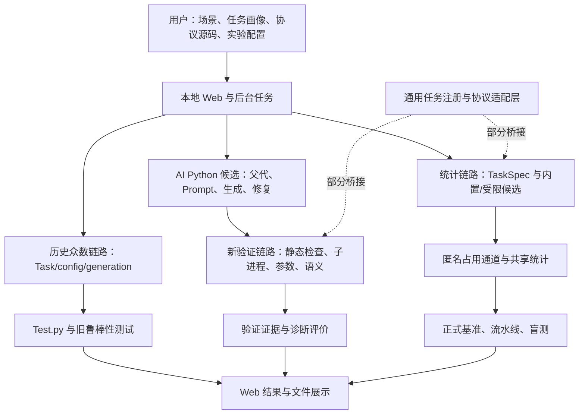

# 中期报告、当前项目与参考论文三方对照分析

> 本文保留 2026-11-02 的核对快照。2026-11-03 已完成任务接入、质量评价、父代更新，以及平台通信计量、精度约束成本选择、冻结后的独立验证和运行控制等迭代。见[平台主线迭代记录](平台主线迭代记录20261103.md)与[平台通信优化与独立验证迭代记录](平台通信优化与独立验证迭代记录20261103.md)。下文对旧版本的缺口判断不应全部视为迭代后现状；项目总目标与中期报告方向保持一致。

核对日期：2026-11-02。当前本地源码提交：`9fabddb6badb7fa57224bc649d84391eec7d02e0`。

本文比较三者的**总体研究内容、总体功能、系统架构、算法机制、技术路线与实验证据**，不按团队成员分工判断完成情况。代码以本地实际实现为准，实验以各自冻结的运行版本为准；本地文件不自动等同于远端仓库内容。

## 1. 总体判断

三者围绕同一个问题展开：**如何根据 RFID 数据采集任务设计和优化协议，在满足结果要求的同时减少通信代价。** 但它们的范围和完成状态不同。

| 对象 | 总体定位 | 主要研究或功能内容 | 当前应如何理解 |
| --- | --- | --- | --- |
| 参考论文 | RFID 协议自动化设计与优化的方法研究 | GRDL 需求表达、需求分解与依赖图、AHP 模板匹配、复合协议构建、通信合并与参数调整，以及 LLM 协议进化 | 提供理论来源和技术思路；部分适配依赖人工，第 5 章还保留未完成的实验说明，不能把全文都当作已充分验证的方法 |
| 中期报告 | 基于大模型的 RFID 通讯协议自优化平台的项目叙述 | 需求建模、基础协议、LLM 生成与迭代、多目标优化、仿真、统计分析、平台展示和硬件应用设想 | 目标覆盖面最大，但研究规划、早期原型、论文方法、预期结果和已完成成果混写，需要逐项核实 |
| 当前项目 | RFID 协议生成、验证与可复现实验的软件平台 | 历史众数协议链路；四任务统计算法与软件通信通道；通用任务接口及候选适配；AI 生成修复；实验、审计和 Web 管理 | 已有可运行的工程系统和可追溯统计实验，但多条链路尚未完全统一；完整需求编译、自动种群进化、多属性流式处理和硬件验证仍有缺口 |

**当前项目最有实质支撑的成果，是“可执行协议原型 + 共享统计采集方法 + 生成验证工具链 + 可复现实验平台”。** 已有工作足以形成完整的软件研究载体，但尚不足以认定中期报告描述的广义“全自动、全任务、全场景、可直接硬件部署的自优化系统”已经完成。

从理论到实现的关系可以概括为：论文提出方法框架，报告扩展为项目目标，代码实现了其中一部分方法和较丰富的实验工程能力。三者不是同一份方案的简单复刻，也不能直接共享性能结论。

## 2. 材料、版本和判断口径

| 材料 | 本次核对范围 | 使用边界 |
| --- | --- | --- |
| [大学生创新创业训练项目中期报告](<../../../大学生创新创业训练项目中期报告 (1).docx>) | 通过 OOXML 提取正文 644 个段落，核对四张表及关键嵌入公式、图表 | 属于内容审阅，没有改写 Word，也未进行整份文件的分页排版验收 |
| [黄昌宇参考论文](../../../毕业设计__黄昌宇.pdf) | 实际题名为《RFID 数据采集协议的自动化设计与优化》，武汉大学硕士论文，2025 年 5 月；重点逐节核对第 2—6 章和关键算法、图表 | 下文采用正文印刷页码，对应 PDF 文件页码加 8；例如正文第 61 页对应 PDF 第 69 页 |
| 当前源码 | 原始协议与测试入口，`generic_tasks`、`generic_protocol`、`stat_protocols`、`benchmark`，AI 工作流、Web、后台任务和旧绘图代码 | 按调用关系和实际计算判断，不用模块名、数据库字段或界面文字代替实现证据 |
| 本地实验档案 | 正式统计套件、六阶段工程流水线、冻结候选、源代码快照、审计及测试日志 | 区分当前代码与历史运行代码，区分真实模型请求、离线固定响应测试和数据重复试验 |

报告封面及声明日期是 **2026 年 3 月**，当前项目与部分实验已更新至 **2026 年 11 月**。以下“当前已实现”不代表“3 月中期阶段已实现”。若修订报告，应明确原阶段成果与后续进展。

本文使用以下判断口径：

- **有方法描述**：文献或报告给出设计思路。
- **有接口或原型**：代码可以表达、适配或执行某项功能。
- **有完整接入**：主要入口能够按一致契约使用该功能。
- **有实验支撑**：存在对应版本、配置、原始结果和评价规则。
- **有硬件验证**：实际读写器、标签、射频环境及测量记录支持结论。

这些层次应分别判断。“有页面”“验证通过”“文件审计通过”和“算法优于基线”表达的是不同事实，不能相互替代。

## 3. 参考论文的总体内容与技术路线

### 3.1 论文解决的核心问题

论文希望把“针对一个新任务重新手写协议”的过程，改造成“表达需求、检索和适配已有组件、组合协议、进一步优化通信”的过程。典型应用是果蔬保鲜，涉及缺失标签、温湿度统计、分位数、极值及类别数量等复合需求。

它不仅研究单个统计算法，还研究**如何把多个具有依赖关系的采集步骤组织成协议，以及哪些通信可以合并或复用。**

### 3.2 需求驱动的设计与优化路线

```text
业务需求
  → GRDL 表达标签集合、属性、操作及通信
  → 分解通信子需求，识别依赖 DAG
  → AHP 特征权重与相似度匹配协议模板
  → 直接复用或人工适配模板
  → 按依赖关系组合复合协议
  → 合并通信、复用参数、结合场景调整
  → 仿真评价精度与通信时间
```

| 阶段 | 论文实际方法 | 对项目有用的借鉴 |
| --- | --- | --- |
| 需求表达 | GRDL 描述 reader/tag 角色、集合、过滤、分组、排序、聚合和通信，正文第 18—23 页 | 把任务语义、可见信息和通信动作写清楚 |
| 需求分解 | 区分需要通信的采集子需求与读写器本地计算，建立依赖 DAG，正文第 23—26 页 | 避免把每个数学运算都重复实现为一次通信 |
| 模板匹配 | 从结构、功能、约束、上下文和过程等维度提取特征，以 AHP 权重计算相似度，正文第 26—28 页 | 协议推荐应有明确特征、匹配依据和适用边界 |
| 协议适配和组合 | 相似度为 1 时直接复用；小于 1 时人工修改 GRDL，再按拓扑关系整合，正文第 28 页 | 论文自身也保留人工参与，不能将其表述为完全自主生成 |
| 通信优化 | 合并重复查询，利用标签集合关系隔离或拆分响应，并要求信息等价、无依赖冲突和参数合法，正文第 39—45 页 | “合并通信”必须保持输出语义与可恢复信息不变 |
| 参数与场景调整 | 利用中间结果缩小后续范围、调整协议参数，并比较不同场景，正文第 46—55 页 | 优化可以来自流程、参数或场景选择，应说明具体来源 |

论文中的 QE 是 **Quartile Estimation，四分位数估计**；FNS 是 **Five Number Summary，五数概括**。FP 及其合并、调整版本属于论文的复合统计任务，不能仅凭名称把它们当成当前代码中的众数协议或四任务统计协议。

### 3.3 LLM 协议进化路线

第 5 章另行提出 LLM 驱动的代码搜索：

```text
基础协议与结构化提示词 → 初始种群
  → 选择父代 → LLM 交叉/变异 → 正确性验证
  → 父代与有效子代合并 → 统一评估适应度
  → 选择 Top-N → 更新当前种群 → 继续迭代
```

关键机制见正文第 61 页算法 12，尤其是第 22—27 行的**父子合并、适应度计算、Top-N 和种群更新**。正文第 62 页的适应度是准确率与时间的归一化加权和，并不是报告提出的吞吐率、时延、误差和能耗四目标公式。

功能、物理参数和信息隔离验证见正文第 65—67 页。论文强调：仿真器为了模拟标签行为而访问属性，不代表读写器算法可以直接获得全部属性或精确碰撞数量。

### 3.4 参考论文的证据边界

第 3—4 章主要使用软件仿真，部分图表分别采用 100 次、50 次重复。论文正文第 53 页的 **58.56%—63.46%** 是其特定任务与成本模型下的结果，不是本项目的收益。

论文也有需要独立校核的地方：摘要仍保留写作说明；正文第 67 页仍出现待填写的软硬件、模型与 API 设置，收敛图被称为“概念图”；第 68 页保留未展开分析及“导出到 Google 表格”等编辑文字。因此，**第 5 章可作为进化方法设计参考，不能把其中描述直接当成已充分复核的进化实验证据。**

算法同样不宜照搬。例如正文第 33 页算法 6 将异常值条件写成 `humidity < lower AND humidity > upper`，当上下界有序时该条件不成立。项目需要按实际语义修正并验证。

## 4. 中期报告的总体内容与技术路线

### 4.1 报告希望构建什么

报告题目为“基于大模型的 RFID 射频识别通讯协议自优化研究平台开发”。总体目标是把任务输入、协议库、LLM 生成、验证、仿真、优化和展示组织成一个可持续迭代的平台。

其规划路线可以整理为：

```text
自然语言/GRDL 需求
  → 需求解析与 AHP 协议推荐
  → 从基础库选取父代
  → LLM 交叉、变异、验证与反馈修复
  → 多场景仿真和多目标评估
  → 更新种群，输出较优协议
  → Web 分析展示，进一步导出硬件实现
```

报告把论文的需求驱动路线与 LLM 进化路线组合成了较大的项目目标，又增加了流式统计、物理信道、平台架构和硬件应用设想。这些扩展可以作为研究方向，但需要分别提供实现和实验依据。

### 4.2 报告内部存在三个不同层次

| 内容层次 | 主要位置和内容 | 对比时的处理 |
| --- | --- | --- |
| 研究目标 | 第 1 章的 GRDL 扩展、时间窗口、AHP、完整演化、能耗、真实信道及硬件等 | 保留为目标，不能自动计入完成成果 |
| 早期可运行原型 | 第 2 章和第 5 章较多描述 `Task.py + config.py + generation* + IProtocol + Validator`，以单众数/多众数为案例 | 与历史文件式、桌面原型及众数测试链路对应 |
| 已完成和预期结果 | 第 3、4、6 章中既有完成式叙述，也有明确标为“预期”的结果表 | 逐项寻找代码和原始记录；保留原本的预期属性 |

报告对平台架构的口径也未统一：摘要出现分布式缓存与高并发，第 1 章同时涉及前后端分离和 Tkinter，第 4 章又描述 FastAPI/ECharts。它们不能共同视为当前同一个系统的实际架构。

因此，报告的主要问题并非研究方向本身不合理，而是**不同阶段、不同证据层级和不同技术路线没有清楚分开**。

## 5. 当前项目的总体架构与实际功能

### 5.1 项目已有三个演进层次

| 层次 | 核心内容 | 已形成的能力 | 目前边界 |
| --- | --- | --- | --- |
| 历史众数协议原型 | `Tag`、`Frame`、`IProtocol`，场景文件、五类基础 ModeQuery 与世代目录 | 协议发现、执行、结果比较和敏感性演示，构成最早的研究原型 | 使用历史输出、正确性与自报时间口径；目录世代不自动证明实际进化选择 |
| 四任务统计研究链路 | `TaskSpec`、匿名占用通道、共享直方图、统计协议、正式基准 | 均值、总体方差、在场标签数和 Top-k；独立通信计数、同数据比较、消融和鲁棒性实验 | 有限整数属性值域上的软件仿真，不是任意连续、多属性、流式 RFID 框架 |
| 通用接口与工程整合 | 任务注册、候选适配、子进程验证、生成修复、运行配置、Web 与证据管理 | 明确语义范围，统一部分契约，改善可执行性、追溯和复现 | 不同入口仍有接入差异，注册和适配不等于全部进入同一正式基准 |

这三层之间有继承和适配，也保留并行入口。当前状态更适合称为“正在统一的软件研究平台”，而不是所有任务已通过一条相同链路执行。

### 5.2 主要执行关系



图中“部分桥接”表示接口存在，但任意任务、任意 Python 候选尚不能自动获得完整的统一基准能力。结果可以同时出现在 Web 中，也不意味着它们的评价语义和成本来源一致。

### 5.3 当前总体功能清单

| 功能域 | 已核实的实际功能 | 应保留的限制 |
| --- | --- | --- |
| 场景和资源管理 | 场景目录、Task/config、协议、Prompt 等文件的管理、导入、预览和下载；路径及格式检查 | 文件资产管理不等于需求语言编译或真实业务数据接入 |
| 编辑一致性 | SHA256 修订身份、冲突返回与原子替换 | 解决本地文件覆盖冲突，不等于多用户权限系统 |
| 任务与结果契约 | 任务注册、规范任务映射、TaskSpec、运行及评价结果对象，显式语义范围 | 众数、中位数、缺失盘点、自定义任务与正式四任务的接入程度不同 |
| 协议研究 | 五类历史众数协议；统计轮询、理想全识别、单任务串联、共享、固定与自适应复核、随机参数及真实候选适配 | 未发现报告所称 ALOHA/DFSA/Q/树形全谱系统一实现与实验 |
| AI 工作流 | 模型接口配置、预览与真实请求、父代源码输入、候选保存、验证、反馈修复、逐次记录 | 生成成功是满足验证/烟测门槛，不是自动优于父代或基线 |
| 验证和执行 | AST、导入/调用白名单、运行时信息边界、资源限制、物理参数与任务语义检查 | 新验证能力没有覆盖所有旧测试入口；参数检查不能代替射频标准符合性 |
| 实验自动化 | 固定种子和数据身份、配置化批量运行、原始 CSV/JSON、汇总、区间、失败原因、Pareto 和图表 | 任意自由 Python 候选尚未获得与统计通道同等级的独立通信计量 |
| 盲测与审计 | 开发/验证/盲测 split、参考数据重叠检查、候选冻结、源码快照、产物 hash 和确定性复现 | 查重范围限于提供或归档的参考数据；hash 不能证明结论正确 |
| Web 与任务管理 | 本地页面、后台进度、候选证据、验证记录、实验历史、结果筛选、图表、下载与审计 | 本地有界任务平台，不是分布式高并发生产系统 |

当前 Web 入口使用标准库 `ThreadingHTTPServer`，前端为 HTML/JavaScript/CSS，后台为本地 `ThreadPoolExecutor`，数据持久化使用 SQLite。任务线程池为 2、排队有上限；活动任务状态保留在进程内，重启后不能按原轮询流程继续执行旧任务。

旧 Tkinter 的本地 `users.json` 账户功能不能代表当前 Web 已实现多用户认证、会话与权限隔离。SQLite 的历史 GRDL/AHP 字段也不能证明对应算法已经实现。

### 5.4 历史众数链路仍是总体功能的一部分

早期核心任务是：给定标签集合及属性值域，找出出现频次最高的属性值。基础协议并不是五种完整无线标准，而是围绕该任务采用不同识别或估计机制的 Python 原型。

| 原型 | 实际使用的主要机制 | 在项目中的作用 |
| --- | --- | --- |
| `ModeQueryEE` | 按属性值逐一查询，通过识别与静默的模拟过程计数 | 精确计数思路的高成本对照 |
| `ModeQueryID` | 模拟逐标签识别并读取属性，再在本地统计众数 | 全量读取后处理的对照 |
| `ModeQuerySEM` | 分批处理属性值，通过位编码及匿名聚合帧估计频次 | 比较批量估计与逐值查询的差异 |
| `ModeQueryTCS` | 对各属性值发起探测，以非空时隙数作为群体规模评分 | 基于占用状态的众数启发式 |
| `ModeQueryTKQ` | 使用 SOG 字符串、OR 聚合和多轮统计估计 | 另一类概率统计原型 |

这一链路通常由场景 `Task.py` 生成 `Tag(id, price)`，`config.py` 固定规模、值域与重复次数，从 `generation*` 加载协议并调用 `IProtocol.execute()`，返回估计列表、辅助指标、自报模拟时间及参数字典，随后生成结果和曲线。

因此，当前项目既有众数查询研究原型，也有后续四任务统计路线，不能只用后者概括全部功能。与此同时，源码中“物理层模拟”“严格隔离”等注释只是设计说明，不能代替实际边界验证；这些历史原型的输出与成本也不能直接混入新统计基准。

## 6. 三方总体功能与技术路线逐项对照

| 维度 | 参考论文 | 中期报告 | 当前项目与总体判断 |
| --- | --- | --- | --- |
| 问题范围 | 需求驱动的 RFID 数据采集协议设计和优化 | 大模型驱动的综合自优化平台 | 已实现协议实验与生成验证工作台；通用自动优化目标尚未全部落地 |
| 需求输入 | GRDL 形式化需求 | 自然语言、扩展 GRDL、类型和时间窗口 | 任务画像、TaskSpec、自然语言 Prompt；没有完整 GRDL 编译链 |
| 需求分解 | 通信子需求及依赖 DAG | 自动解析、组件化生成 | 四任务共享和适配机制已有；没有从任意复合需求自动提取 DAG 的实现 |
| 协议推荐 | AHP 权重、特征相似度与模板匹配 | 自动推荐、冷启动、毫秒检索 | 主要为用户选择协议/父代和固定注册；未发现完整 AHP 推荐计算 |
| 数据模型 | 包含集合及多属性的复合应用 | 连续数据、多维属性、动态统计 | 主要标签对象为 ID 与单个整数 `price`；缺少统一多属性及时序数据链 |
| 协议库 | 围绕统计和盘点需求复用经典组件 | ALOHA、DFSA、Q、树形及草图全谱系 | 历史库以五类 ModeQuery 为主，另有统计基线；范围与报告不同 |
| 任务覆盖 | 盘点、均值、中位数、四分位数、极值、类别基数等复合需求 | 众数、连续/流式统计、缺失检测等 | 正式基准固定均值、总体方差、在场标签数、Top-k；其他任务多为旧语义或有限适配 |
| 复合优化 | 组合不同组件并合并通信、复用中间结果 | 自动组件复用和联合优化 | 主要共享同一份估计直方图计算多个结果；未实现一般组件通信自动合并器 |
| LLM 作用 | 代码交叉、变异与种群搜索 | 核心自主优化引擎 | 自由 Python 生成/修复与受限 JSON 参数生成两种路线，证据能力不同 |
| 进化选择 | 父子合并、Top-N、种群更新 | 动态选择、精英保留和收敛 | 自动迭代仍轮转初始父代组合，缺少评估驱动的种群更新闭环 |
| 优化目标 | 准确率与时间的归一化加权 | 吞吐率、时延、误差、能耗 | 旧展示为准确率/时间得分；新基准有误差和通信 Pareto，尚未成为完整进化选择 |
| 场景适应 | 场景比较与参数调整 | 自主适应、动态多场景优化 | 有分布、扰动实验和轮内停止策略；未证明能自动为新场景选择最优协议 |
| 正确性 | 功能、物理、信息隔离 | 三重门禁和标准合规 | 新验证链路已有五阶段和资源限制；旧入口未完全统一，物理层仍是抽象约束 |
| 实验输出 | 仿真比较和方法结果 | 多代曲线、性能提升、跨场景优势 | 新基准具备原始结果和快照；报告中的部分旧数字和图仍未对应真实运行档案 |
| 工程交付 | 研究原型与方法论 | 桌面/Web、模型服务、代码导出、硬件应用 | 本地 Web 和软件实验工程较充实；未找到 C/C++ 转换及可烧录硬件工程 |

## 7. 关键算法和运行机制的实质差异

### 7.1 GRDL/AHP 与任务注册不是同一层能力

当前任务画像能规定输出格式、真值来源、指标和语义范围，TaskSpec 能固定数据分布、规模、值域、扰动和种子。这些是实质性的结构化接口建设。

但完整 GRDL/AHP 还需要语法分析、类型与表达式求值、通信需求提取、DAG、特征向量、判断矩阵、一致性与匹配计算。当前未发现相应完整执行链。因此可以说“借鉴需求形式化思想建立任务契约”，不能说“已完成论文中的 GRDL 自动设计系统”。

接口扩展还存在具体断点：`generic_tasks` 注册了 `top_k`，但 AI 的 `TASK_GUIDANCE` 未包含该键，`task_guidance()` 在画像校验后直接访问该字典。仅注册新任务并不能保证提示词链路自动支持它。

### 7.2 论文的协议合并与当前共享统计采用不同机制

论文以不同统计组件为起点，研究在依赖和信息等价约束下合并查询、响应和参数。当前四任务链路则先估计一份属性频次直方图，再由这份共享中间结果计算多个答案。

当前统计算法大致为：

1. 标签使用稳定 ID 哈希，在自身属性值对应的 `m` 个槽中选择一槽发送一位响应。
2. 同槽响应按 OR 聚合，读写器获得占用状态，不直接获得精确碰撞人数。
3. 对每个属性值，根据空槽数 `Z` 估计频次：`count_hat = log(Z / m) / log(1 - 1 / m)`。
4. 由估计频次加权计算均值、总体方差、在场数量和频次 Top-k。
5. 固定多轮或依据 Top-k 边界差距的启发式追加观测，达到上限或满足停止条件后输出。

这是可运行的共享采集方法，也是当前正式算法实验的主体。其限制同样明确：

- 依赖已知有限整数值域，正式 TaskSpec 目前限制值域不超过 10,000 桶；不是任意连续属性的直接处理。
- `SharedStatSketch` 实际保存直方图计数，`heavy_hitter_capacity` 未限制该字典；不能仅凭名称宣称实现了固定容量的通用流式重频草图。
- `Z=0` 时有截断和饱和记录，不能把估计式解释为所有负载下都无偏或可靠。
- 自适应策略使用边界分离启发式，并非已经证明覆盖率的统计置信保证；追加轮次仍是整帧重新观测，不是只针对少量候选的定向复核。

所以，两者可以对应到“复用信息、减少重复通信”的共同思想，但当前代码并未复现论文全部合并规则、FP/OFP 协议及应用语义。

### 7.3 三种“自动优化”需要分别说明

| 机制 | 当前实现 | 与完整自主优化的距离 |
| --- | --- | --- |
| 协议内自适应 | 依据 Top-k 边界启发式决定是否继续观测 | 属于单次协议执行中的轮数控制，不是跨场景选择或种群进化 |
| LLM 候选生成与修复 | 输入父代/任务，生成 Python，验证失败后反馈修复，记录尝试 | 能形成有效候选，不保证结果比父代更好 |
| 评估驱动的进化 | 有世代目录、父代引用和自动多次生成 | 尚缺父子统一评估后更新下一代种群的关键闭环 |

`run_selfopt_auto_iterate()` 在开始时建立父代组合，随后通过 `pairs[index % len(pairs)]` 轮转。成功子代虽可保存并记录，初始组合不会由其适应度自动更新。它不等同于论文算法 12。

旧绘图入口计算的 `0.65 × accuracy + 0.35 × time_score` 主要用于整理展示，也不是报告四目标公式的运行实现。Pareto 结果页面则属于评价工具；**有 Pareto 展示不等于使用 Pareto 驱动多目标进化。**

### 7.4 两种 LLM 候选的能力边界

| 候选类型 | 搜索或生成空间 | 已有验证/评价 | 不能直接推出 |
| --- | --- | --- | --- |
| 自由 Python 协议 | 在提示词与验证约束下生成协议代码，可反馈修复 | 静态和运行时检查、任务烟测、诊断评价、父代与尝试追溯 | 自报通信成本可信、优于基线、已接入正式统计 Pareto |
| 受限统计 JSON 候选 | `anonymous_histogram` 及轮数、槽数、阈值等白名单参数 | 编译为既有统计机制，由通道独立计数，可进入对应正式比较 | 发现任意新协议结构、完成自由代码进化或大规模自主搜索 |

正式统计套件的真实候选属于第二类。随机参数控制 `random_sketch_control` 不是 LLM 生成。离线固定响应的修复测试也不能当作真实模型优化效果。

### 7.5 任务语义与数据扰动需要一致

| 名称 | 当前实际含义 | 与论文/报告可能混淆的地方 |
| --- | --- | --- |
| 均值、方差 | 单个整数属性的均值、总体方差 | 不等于完整连续时间流、多属性传感器统计 |
| 基数 | 扰动后实际在场的标签数量 | 不等于属性去重数，也不等于识别哪些库存 ID 丢失 |
| Top-k | 频次最高的 k 个属性值，并列按数值升序 | 与返回全部真实众数、类别基数和分位数不是同一任务 |
| 分布 | 单峰、多峰、高斯、长尾、均匀等属性值分布 | 不是标签物理空间、距离或遮挡分布 |
| 噪声 | 将部分属性替换成值域内随机整数 | 不是 AWGN、瑞利衰落或射频解码错误 |
| 缺失 | 删除部分标签，对剩余集合重新计算真值 | 不直接评价缺失 ID 恢复能力 |
| 极端值 | 将属性替换成值域端点 | 不是无线多径、捕获效应或动态干扰 |

噪声和缺失场景评价的真值是**扰动后的实际总体**。估计误差低不能据此宣称恢复了污染前的属性、找回了缺失标签，或通过了真实无线鲁棒性验证。

## 8. 平台集成、验证与通信成本的总体边界

### 8.1 各链路的评价标准还没有完全统一

| 入口 | 当前行为 | 对总体功能的影响 |
| --- | --- | --- |
| 旧 `Test.py` | 直接导入协议，在各协议各轮次重新生成数据；众数正确性使用非空输出为真值集合子集的判定；接收候选自报时间 | 不是全众数集合相等，也未在该路径提供统一数据身份和新严格沙箱 |
| 旧 `Validator.py` | 直接调用协议并进行旧参数检查 | 不等于新验证器的五阶段能力 |
| 旧 `Experiments/Test_robust.py` | 扫描规模、占比、值域等因素，但丢弃结果和真值，主要记录协议自报时间 | 可以生成时间敏感性曲线，不能同时证明准确性或算法公平性 |
| 新 AI 验证入口 | 经静态检查、受控子进程、参数和任务语义检查，记录诊断证据 | 工程检查更充分，但自由 Python 成本仍属自报，不进入正式通信 Pareto |
| 新统计基准 | 相同数据和 dataset hash，通道独立计数，四任务语义明确 | 正式比较口径更清楚，支持范围仍限定于现有任务和统计协议 |

Web 启动旧测试时虽然使用外层子进程和超时，但这只把整个旧测试与 Web 进程分开，不能解释为每个候选都经过新严格沙箱。旧入口中宽松的众数判定也仍然存在，不能把新语义检查的改进表述为“全项目所有入口均已修复”。

配置化基准也存在适配边界：`benchmark/run_config.py` 使用固定的四任务顺序和协议集合，将众数、中位数/分位数、缺失盘点、自定义任务明确列为非正式基准任务；实际运行调用统计协议注册表，不能直接把任意 Python 文件当作同等级正式候选。该入口虽允许配置 `llm_random` 名称，调用 runner 时未传入真实候选记录，不能假定只勾选此项就会完成真实 LLM 候选实验。

因此，当前“通用接口”的准确含义是**已有可扩展契约和部分桥接**，而不是全部历史与新增任务已统一获得同等强度的验证、独立计量和盲测。

### 8.2 新验证体系有哪些实质成果

新链路已实现 AST 分析、导入/调用白名单、标签访问代理、运行时审计、严格/兼容模式、子进程超时及内存/进程/输出限制，以及物理参数和任务语义检查。对缺少可用真值的任务，也能明确保留“语义未评估”状态，而不是强行判定正确。

这些是可据实记录的平台能力，但尚不构成任意 Python 程序的完备信息流证明。标签侧辅助函数通过约定前缀获得仿真读取权限，仍需审查权限边界；匿名直方图也会暴露总体分布，不能称为密码学隐私保证。

物理检查目前主要核对声明参数是否为合法数值及是否超过位宽、帧长等边界。它未验证完整 EPC 指令、RF 时序、编码、调制和真实硬件行为。

### 8.3 成本模型不能混成同一种“时间”

| 成本口径 | 实际含义 | 比较时的要求 |
| --- | --- | --- |
| 论文仿真成本 | 正文第 34—35 页及第 48—49 页按查询位数、回复时隙位数和帧开销估算；帧开销使用 40 ms | 复用论文数字时必须保留其任务与模型 |
| 当前统计成本 | 独立记录 `reader_bits/tag_bits/slots/frames/rounds`，默认读写器每位 0.025 ms、标签每位 0.4 ms、每逻辑帧 30 ms，槽和轮次额外系数默认 0 | 它是显式软件模型，不是已测量的空口时间或能耗 |
| 自由 Python 时间 | 候选返回的时间或诊断信息 | 必须标记自报，不能与通道独立计量结果混排为同等级证据 |
| Python 执行耗时 | 本机运行软件仿真的墙钟时间 | 受实现、缓存和设备影响，不代表 RFID 通信时延 |

当前 `tag_bits` 是每标签实际发射的位数贡献；多个标签可能同时占同一槽，空槽也会消耗无线时间，所以**发射位数与无线占用时长并不相等**。默认成本系数忽略槽时长时，更不能直接转换成真实吞吐率或能耗改善。

此外，一次统计观测包含“值域大小 × 每值槽数”个逻辑槽。值域 1..1000、每值 256 槽时有 256,000 槽，但记录为一个逻辑模型帧；尚未拆分成符合物理帧长限制的无线帧。新验证器对声明帧长的检查，不能证明该统计模型已经完成真实帧映射。

轮询和全识别也是当前定义的基线，其中全识别采用无碰撞乐观模型；不能直接改名为报告中的 DFSA 或 Q 算法。

## 9. 三方实验内容与现有证据对照

### 9.1 不同实验回答的是不同问题

| 对象 | 主要实验内容 | 可以支持什么 | 不应直接推出什么 |
| --- | --- | --- | --- |
| 论文第 3—4 章 | 果蔬保鲜复合协议、通信合并、参数调整和场景比较 | 对相应方法的仿真分析 | 本项目实现了同样协议或获得同样收益 |
| 论文第 5 章 | LLM 进化框架、验证与概念性结果叙述 | 进化实验的设计参考 | 已有足够可复核的模型、多次运行和收敛证据 |
| 报告第 4—5 章 | 盘点/统计性能表、历史众数案例、敏感性与多代曲线 | 部分原型展示；具体数字需逐项补原始证据 | 所有图表均由当前系统同一评价链路实测生成 |
| 当前正式统计套件 | 四任务、共享采集、复核消融、敏感性、扰动和盲测 | 指定软件通道和场景中的统计结果 | 真实 RF 优势、完整种群进化效果或任意任务泛化 |
| 当前工程流水线 | 六阶段执行、源码/产物审计、盲测确定性重放 | 实验工程可执行、可追溯、可复现 | 算法一定更优或同一次盲测重放带来额外独立样本 |

### 9.2 正式统计套件的规模与版本

目录：[yanxiao_20261102_586da5f2](../../code_add/Experiments/stat_protocols/runs/yanxiao_20261102_586da5f2)。

| 项目 | 实际归档内容 |
| --- | --- |
| 主实验范围 | 20 个数据 seed、五类属性分布、1k/10k/100k 标签 |
| 任务结果行 | main 8400、ablation 8400、composite 1800、sensitivity 8400、robustness 9600、blind 1440，共 **38,040 条** |
| 记录解释 | 共享采集的多任务行引用同一次采集，不是全部互相独立的通信试验 |
| 可追溯材料 | manifest、源码快照、冻结候选、Prompt/响应、数据身份与产物 hash |
| 本次只读复核 | 44 项文件审计通过；归档 40 个相关源码文件中 12 个与当前文件不同，属于运行后保留历史快照的正常版本差异 |

这套数据可以作为项目自身的统计实验依据，但需注明归档版本，不能把全部结果写成由最新提交重新运行所得。

### 9.3 已有算法假设的实际结论

| 假设 | 评价门槛 | 归档结果 | 合理结论 |
| --- | --- | --- | --- |
| H1：共享统计采集 | 三任务共享通信节省至少 15%；均值、方差、基数误差均值的 95% CI 上界分别不超过 5%、10%、5% | **43/45** 个分布×规模×任务条件通过 | 共享采集在多数已测条件下达到预设要求，但不是所有条件都达标 |
| H2：复核精度与通信权衡 | 相对 `fixed_4`，逐 seed 配对 F1 损失的 95% CI 上界不超过 1 个百分点，发射位数节省至少 20% | 默认 `adaptive` 为 **3/15**；全部六种比较策略合计 **13/90** | 存在条件性收益，尚不支持自适应复核普遍更优 |
| H3：进化选择与修复收益 | 需要真实进化、多次独立运行与相应对照 | 归档标记为 **`out_of_scope`** | 当前统计套件没有验证完整进化算法的收益 |

H1 未通过的是长尾分布、10 万标签下的均值和基数，误差均值的区间上界分别约 **5.265%**、**5.212%**。三任务共享相对三次串行采集节省 2/3，主要来自复用同一次采集的结构；这不是 LLM 自动发现 2/3 优化的证据，也不意味着硬件时间或能耗同比下降。

H2 的 3/15 是分布×规模条件数，13/90 是策略×条件数，都不是模型生成成功率。启发式边界分离值与这里跨 seed 汇总误差的 95% CI 也不是同一个统计量。

### 9.4 真实 LLM 证据的范围

正式套件冻结了一个真实生成候选：`290537f3a8314c0b933ce4063b95f79f`，模型为 `gpt-6.1-sol`，采用 `anonymous_histogram`，参数为 3 轮、每值 128 槽、阈值 1.75，并保留模型、Prompt/响应 hash 和用量记录。

它证明受限统计参数候选可以由真实模型产生并进入实验，但不能证明多代进化已经有效。20 个数据 seed 评价输入随机性，不代表 20 次独立模型生成。

按该候选跨场景归档结果汇总，均值/方差/基数各 300 条任务结果的质量达标率为 93.33%，Top-k 的完全匹配率约 35.67%、平均 F1 约 0.6811。这些是指定候选的描述性结果，不能转换为“LLM 整体优于所有基线”的结论。

### 9.5 与当前源码对应的工程证据

目录：[84699e474c614f51b8d7a3bd93372802](../../code_add/Experiments/stat_protocols/pipelines/84699e474c614f51b8d7a3bd93372802)。

- 四任务、四协议；uniform/long_tail；1000 标签；值域 1..64。
- 开发 seeds 0..19、验证 1000..1019、盲测 2000..2019。
- 六阶段各 640 条，共 **3840 条**；同一盲测双次复现另有 **1280 条**。
- 74 项产物审计通过，双次复现的确定性字段 hash 一致，manifest 中 44 个源码 hash 与当前对应文件一致。

这组证据说明当前工程链路能够运行和重建结果。重放不是新增独立盲测，也不能替代正式套件的规模覆盖。产物 hash 审计验证完整性与一致性，不自动证明算法正确、研究假设成立或不存在未记录的数据使用。

既有 `verification_v2.log` 和独立提交快照验证日志记录 **121 项测试通过**；较早文档中的 77/107 项属于不同迭代阶段。本次文档分析未重新运行全套测试，也未为比较另行调用模型或重跑大规模实验。

### 9.6 报告中尚未对应到原始证据的定量结论

| 报告内容 | 本次核对结果 | 当前处理建议 |
| --- | --- | --- |
| 摘要：1000 标签下效率提高 20%—30% | 未定位到与该百分比对应的基线、候选、配置与逐次运行档案 | 补全证据前，不作为当前已验证结论 |
| §4.2.1：DFSA 12.4 s → SOP 8.5 s，403 → 588 tags/s，漏读率 0.82% → 0.21% | 表内计算基本吻合，但未找到对应 DFSA/SOP 实现与原始运行证据 | 不能用当前四任务统计套件代替该盘点实验 |
| §4.2.2：均值误差 8.5% → 2.1%，方差 15.2% → 4.6%，中位数 12% → 5.3% | 未建立逐 seed 数据、候选、模型配置和表格之间的对应；中位数也不属于当前正式四任务 | 使用可追溯结果重建，或明确其原始来源和适用版本 |
| “方差误差始终在 5% 以内”“跨场景最优” | 当前正式实验并不支持无条件概括，且任务门槛不同 | 报告条件、指标、区间和失败场景 |
| §4.3.3：SOP-Inventory/Statistic/Adaptive 的收益 | 原表已明确标为“预期” | 保留为目标，不能在结论中转为已实测成果 |

“未定位到原始证据”不等于认定实验从未发生。若数据位于其他位置，需要补齐任务、数据、协议源码、评价和图表的对应关系。

### 9.7 旧图表需要单独说明来源

报告图 5-4 对应的 [Experiments/plot.py](../../code_add/Experiments/plot.py) 直接定义曲线数组，OFP 数据通过下式生成：

```python
improvement_rate = np.linspace(0.6346, 0.5856, len(num_tags))
data['OFP'] = data['original'] * (1 - improvement_rate)
```

脚本未读取逐次实测数据，预设区间与论文正文第 53 页的收益范围一致。目前能确认的是按给定数组绘图，不能确认本项目测得了同样优化。QE/FNS 的解释还与论文原意不符，论文的复合保鲜任务也不能直接归入单峰众数案例。

图 5-2 所述纠正次数下降同样需要重新对应记录：旧 `build_iot_report_assets.py` 将纠正次数赋为 1，旧 `web_app.py` 根据文件名前缀赋 0/1，并用上一目录排序推断父代。这些字段不足以作为真实修复次数和谱系的研究证据。新的 journal 已保留实际生成修复记录，应以其重新统计。

图 5-1 终端截图为 `--scene multi_mode all`，文字却使用单峰案例叙述；图 5-3 的历史敏感性曲线也需要补齐数据与成本口径。历史演示可以保留，但应标注历史版本、任务和数据属性。

## 10. 当前项目的总体缺口与改进顺序

以下按系统功能整理，不分配到任何个人，也不把论文中的所有设想都强制变成当前项目必做项。应先明确项目的研究主线，再决定扩展范围。

| 顺序 | 系统层面的问题 | 建议工作 | 可以据此判断完成的条件 |
| --- | --- | --- | --- |
| 第一阶段 | 多入口的验证与评价标准不一致 | 梳理旧众数、旧鲁棒性、新 AI 验证、配置基准入口；统一任务语义、数据身份、失败状态和成本来源，或明确隔离为历史模式 | 从 Web/CLI 执行同类任务时，正确性和指标含义一致，旧模式有清楚标识 |
| 第一阶段 | 实现、文档和证据之间映射不完整 | 统一当前架构说明，修正旧图、推断字段及没有原始证据的收益表述，明确历史与当前版本 | 每项已完成能力能定位实现，每项数字能定位配置、源码和原始结果 |
| 第一阶段 | “通用注册”未完整贯通运行入口 | 统一画像注册、提示词、协议适配、配置 runner 和真实候选传递；明确各任务支持等级 | 每项注册任务有入口覆盖表；不支持的组合明确拒绝，不生成空结果或误导性评价 |
| 第二阶段 | LLM 自优化缺少核心选择闭环 | 在相同冻结数据上评价父子，实施精英保留和种群更新，记录每代决策、预算和停止原因 | 子代能依规则成为后续父代；生成有效与性能改进分别统计，可回放选择过程 |
| 第二阶段 | 算法优势的证据仍有限 | 分开验证共享采集、复核策略、单次 LLM 参数生成、自由代码搜索和完整进化；设置随机/无修复/无选择等必要对照 | 多次独立模型运行，成本预算一致，保留失败和未达标条件，不以同一候选的多 seed 冒充多次搜索 |
| 第二阶段 | 通信代价缺少物理映射 | 明确空槽、碰撞、真实帧拆分和时序，分开记录发射量、空口占用、CPU 时间及能耗模型 | 成本可由事件重算，并清楚标注模型假设；不再混用逻辑帧与标准帧 |
| 依研究目标决定 | 尚无完整需求驱动协议设计 | 若以该方向为主线，补 GRDL 或收敛后的任务 DSL、类型/语义、依赖图、模板匹配和组合；不必为套用名词而机械引入 AHP | 至少有一个复合任务从形式化需求到协议组合的端到端案例，并与手工方案比较 |
| 依研究目标决定 | 数据与任务范围较窄 | 逐步扩展多属性、连续值离散化约定、时间窗口、分位数或缺失 ID 语义，并给出对应算法 | 新任务具有输入模型、通信行为、真值、指标和基准，超出画像文字层面 |
| 后续扩展 | 射频、标准与硬件尚未验证 | 根据设备条件增加真实信道、读写器适配和硬件测量；若需要 C/C++，单独建设目标工程 | 有实际设备、部署步骤、日志和测量记录，再提出硬件或标准兼容结论 |

**最值得优先推进的不是继续增加功能名称，而是统一已有链路，并补齐“生成候选 → 独立评价 → 选择 → 更新下一代”的研究闭环。** 这直接对应项目题目中的“自优化”。若暂不实现完整进化，应将当前成果表述为“生成与评估平台”，避免提前承诺自动优化效果。

与此同时，H2 中多数条件未达标应作为算法研究问题保留：需分析饱和、并列边界、阈值和轮数代价，而不是仅靠增加测试、图表或平台页面来宣告解决。

## 11. 建议采用的总体技术定位与报告组织

### 11.1 理论来源、技术借鉴与项目贡献的关系

| 层次 | 建议表述 |
| --- | --- |
| 理论来源 | 黄昌宇论文中的需求形式化、协议复用与组合、通信优化，以及功能/物理/信息边界验证思想 |
| 技术借鉴 | 用结构化任务约束生成过程，用验证反馈修复候选，统一评价精度与代价，并考虑 LLM 搜索 |
| 当前具体实现 | 文件式众数原型、匿名占用通道上的四任务共享统计、通用契约与适配、候选证据链、可复现实验和本地 Web |
| 当前可证明结果 | 指定软件模型和归档条件下的共享通信与误差表现、复核权衡，以及工程执行/复现/审计结果 |
| 后续研究目标 | 评估驱动的完整进化、需求编译与组合扩展、多属性/时序任务，以及物理映射和硬件验证 |

这里的“具体实现”不自动等同于经过文献检索确认的学术创新。若要使用“首次”“填补空白”“全场景最优”等判断，仍需要相关工作比较和相应证据。

### 11.2 可以直接采用的项目定位文字

> 本项目以 RFID 数据采集协议的自动化设计与优化研究为理论来源，借鉴需求形式化、协议复用、通信优化及多维验证思想，构建面向协议原型生成、验证和比较的软件实验平台。当前平台保留众数查询协议原型，并围绕有限整数属性值域实现均值、总体方差、在场标签数和 Top-k 的共享统计采集，提供候选生成与反馈修复、任务契约、受控执行、可复现实验、结果审计及 Web 管理。现有实验反映指定软件通信模型下的表现；完整评估驱动的种群进化、通用需求编译、多属性流式处理和真实硬件部署仍为后续研究内容。

### 11.3 总体报告应如何重组

| 报告部分 | 建议内容 |
| --- | --- |
| 问题与目标 | 定义 RFID 任务、结果要求与优化代价，清楚区分当前研究范围和长期目标 |
| 理论与相关工作 | 就地引用 GRDL、AHP、协议组合和 LLM 进化来源，指出采用、修改与未实现部分 |
| 系统架构 | 按当前真实 Web、任务接口、协议运行、验证、实验和证据存储描述；历史 Tkinter 单列版本演进 |
| 核心方法 | 分开说明共享统计方法、LLM 自由 Python 工作流、受限参数候选和已有适配机制 |
| 实验设计与结果 | 固定任务和成本语义；用本项目原始记录生成表图；报告条件、区间、失败与预算 |
| 局限与后续工作 | 明确 H2 未普遍成立、H3 未覆盖、入口未完全统一和无硬件验证等边界 |

参考文献目前只有四篇 RFID 文献，未列入这份主要参考硕士论文，也缺少 LLM 演化方法的具体来源，应补齐。引用或改绘文献图表时，还需注明展示的是文献结果、示意数据还是本项目实测数据。项目编号、字体说明、目录页码和第 6 章子节编号等模板残留应一并清理。

**整体结论：当前项目已有较充实的软件平台和统计实验基础，与论文在问题方向、协议复用和验证思想上关联明确；与报告相比，实现范围更具体、更受约束。后续工作的重点是统一已有能力和评价标准、完善真实自优化闭环，并让每项总体结论都对应本项目自身的实现与证据。**

## 12. 主要证据索引

| 主题 | 主要位置 |
| --- | --- |
| 原始标签、帧与协议接口 | [base.py](../../code_add/base.py) |
| 历史基础众数协议 | [base_protocol](../../code_add/base_protocol) |
| 历史众数与鲁棒性评价 | [Test.py](../../code_add/Test.py)、[Validator.py](../../code_add/Validator.py)、[Test_robust.py](../../code_add/Experiments/Test_robust.py) |
| 任务注册与语义范围 | [profiles.py](../../code_add/generic_tasks/profiles.py) |
| 正式任务、结果和成本契约 | [contracts.py](../../code_add/stat_protocols/contracts.py) |
| 共享统计核心 | [channel.py](../../code_add/stat_protocols/channel.py)、[sketches.py](../../code_add/stat_protocols/sketches.py)、[protocols.py](../../code_add/stat_protocols/protocols.py) |
| 受限候选编译 | [genotype.py](../../code_add/stat_protocols/genotype.py) |
| 场景与配置化入口 | [scenarios.py](../../code_add/benchmark/scenarios.py)、[run_config.py](../../code_add/benchmark/run_config.py) |
| 统计方法与实验规范 | [统计模块说明](../../code_add/stat_protocols/README.md)、[统计实验规格](../统计实验规格v1.md)、[统计实验验收](../统计实验交付验收.md) |
| 五阶段验证与信息边界 | [validation.py](../../code_add/generic_protocol/validation.py)、[security.py](../../code_add/generic_protocol/security.py) |
| 子进程与资源限制 | [subprocess_worker.py](../../code_add/generic_protocol/subprocess_worker.py)、[runtime_limits.py](../../code_add/generic_protocol/runtime_limits.py) |
| AI 生成、修复和尝试记录 | [ai_protocol_optimizer.py](../../code_add/ai_protocol_optimizer.py)、[journal.py](../../code_add/generic_protocol/journal.py) |
| Python 候选诊断评价 | [validation_evidence.py](../../code_add/generic_protocol/validation_evidence.py) |
| 当前 Web、自动迭代与旧展示字段 | [web_app.py](../../code_add/course_project/web_app.py)，重点为 `run_selfopt_batch_test()`、`run_selfopt_auto_iterate()` 及旧结果整理部分 |
| 平台任务、持久化与文件资源 | [jobs.py](../../code_add/course_project/jobs.py)、[database.py](../../code_add/course_project/database.py)、[assets.py](../../code_add/course_project/assets.py) |
| 实际谱系及实验工程服务 | [engineering_service.py](../../code_add/course_project/engineering_service.py) |
| 历史图表数据来源 | [plot.py](../../code_add/Experiments/plot.py)、[build_iot_report_assets.py](../../code_add/course_project/build_iot_report_assets.py) |
| 正式统计套件与假设结果 | [manifest.json](../../code_add/Experiments/stat_protocols/runs/yanxiao_20261102_586da5f2/manifest.json)、[hypotheses.json](../../code_add/Experiments/stat_protocols/runs/yanxiao_20261102_586da5f2/hypotheses.json) |
| 当前工程流水线与重放 | [pipeline_manifest.json](../../code_add/Experiments/stat_protocols/pipelines/84699e474c614f51b8d7a3bd93372802/pipeline_manifest.json)、[replay_report.json](../../code_add/Experiments/stat_protocols/pipelines/84699e474c614f51b8d7a3bd93372802/replay/replay_report.json) |
| 121 项测试既有记录 | [verification_v2.log](../../code_add/course_project/outputs/engineering_check/verification_v2.log)、[release_snapshot_verify.log](../../code_add/course_project/outputs/engineering_check/release_snapshot_verify.log) |
| 本次阅读辅助材料 | [report_review_20261102](../../code_add/course_project/outputs/report_review_20261102)，包括全文提取、关键图像和 PDF 页面渲染 |

上述实验目录与日志为本地归档，其中部分未纳入源码提交。他人克隆后不应假设自动拥有全部证据，需取得对应归档或按实验说明重新生成。

本次只重写本分析文档，没有修改报告、协议算法或其他工程文件，也没有提交或推送。
